<p align="center">
  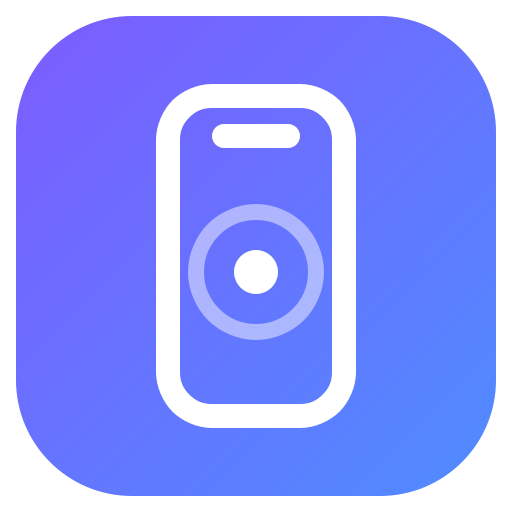
</p>

<h1 align="center">Phone Bridge — پل گوشی ↔ کامپیوتر</h1>

<p align="center">
  <b>گوشی اندرویدت را با موس و کیبورد کامپیوتر کنترل کن — و از گوشی به‌عنوان کیبورد، تاچ‌پد و ریموت ارائه برای کامپیوتر استفاده کن.</b><br>
  مینیمال، سریع، دوزبانه (فارسی · English). بدون ابر، بدون حساب کاربری، بدون نصب برنامه روی گوشی.
</p>

<p align="center">
  <a href="https://github.com/YOUR_USERNAME/phone-bridge/actions/workflows/ci.yml"></a>
  
  
  
</p>

<p align="center">
  <a href="README.md">English</a> · <a href="README.fa.md"><b>فارسی</b></a> ·
  <a href="docs/fa/getting-started.md">شروع سریع</a> ·
  <a href="docs/fa/usage.md">راهنمای استفاده</a> ·
  <a href="docs/fa/features.md">همه‌ی امکانات</a> ·
  <a href="docs/fa/troubleshooting.md">رفع مشکل</a>
</p>

<p align="center">
  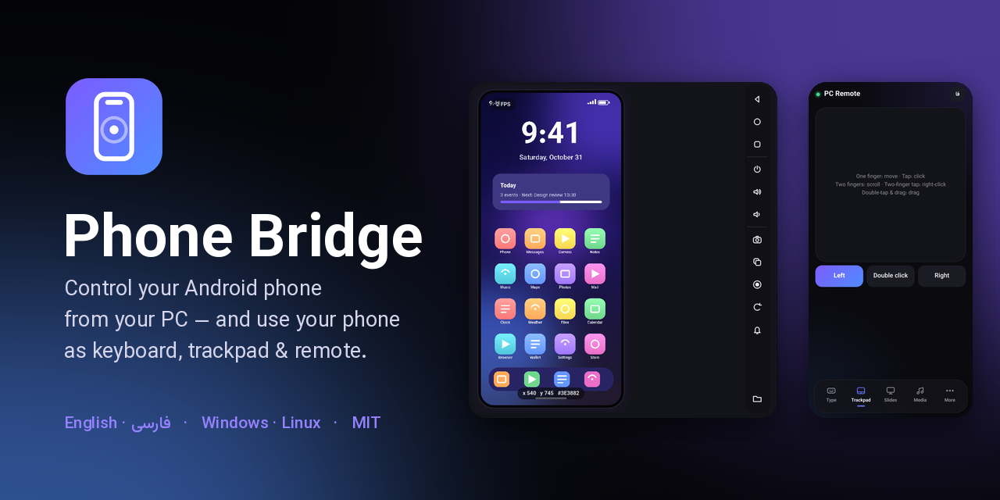
</p>

<div dir="rtl" align="right">

---

## این برنامه چیست؟

Phone Bridge یک برنامه‌ی دسکتاپ (Python و Qt) است که کامپیوتر و گوشی اندرویدت را از طریق شبکه‌ی خودت و در **هر دو جهت** به هم وصل می‌کند:

| جهت | چه چیزی به‌دست می‌آوری | چطور کار می‌کند |
|---|---|---|
| **کامپیوتر ← گوشی** | دیدن زنده‌ی صفحه‌ی گوشی، لمس و swipe و اسکرول با **موس**، تایپ با **کیبورد**، اسکرین‌شات، ضبط ویدیوی صفحه، مدیریت فایل و برنامه‌ها، خواندن لاگ و … | ابزار [`adb`](https://developer.android.com/tools/adb) از طریق کابل USB یا Wi-Fi |
| **گوشی ← کامپیوتر** | گوشی می‌شود **کیبورد** (فارسی هم)، **تاچ‌پد** چندلمسی، **ریموت اسلاید**، کنترل صدا و پخش، میانبرهای کیبورد و حتی نمایش صفحه‌ی کامپیوتر | یک صفحه‌ی وب کوچک که برنامه روی شبکه‌ی محلی‌ات می‌دهد؛ فقط لینکش را در مرورگر گوشی باز کن، چیزی نصب نمی‌شود |

> **جایگزین scrcpy برای ویدیوی روان نیست.** نمایش صفحه بر پایه‌ی اسکرین‌شات است (بسته به گوشی و اتصال، چند فریم در ثانیه). برای لمس، تایپ و مدیریت گوشی کاملاً کافی است. اگر ویدیوی روان می‌خواهی، [scrcpy](https://github.com/Genymobile/scrcpy) را کنارش اجرا کن.

## ویژگی‌های اصلی

- **رابط مینیمال و مدرن** — تم تیره و روشن، آیکون‌های برداری، فونت وزیرمتن، کاملاً راست‌به‌چپ. با یک کلیک بین **فارسی ⇄ English** عوض کن.
- **اتصال در چند ثانیه** — با کابل USB، یا با **اسکن QR** از صفحه‌ی *Wireless debugging* گوشی (اندروید ۱۱ به بالا). برنامه گوشی را پیدا می‌کند، جفت می‌کند و وصل می‌شود. حتی می‌تواند خودش `adb` را دانلود کند.
- **نمایش زنده‌ی گوشی** با افکت موج: کلیک = لمس، کشیدن = swipe، چرخ موس = اسکرول، کلیک راست = برگشت، کلیک وسط = خانه، نگه‌داشتن = لمس طولانی. مختصات، رنگ پیکسل و FPS روی تصویر.
- **ماکرو** — ضبط لمس/swipe/کلید، پخش با سرعت ۰٫۵ تا ۴ برابر، تکرار، ذخیره و بازکردن (JSON).
- **اسکرین‌شات و ضبط ویدیوی صفحه** مستقیم روی کامپیوتر (`Ctrl+S` و `Ctrl+R`).
- **مدیر فایل، مدیر برنامه‌ها، Logcat، ترمینال adb**، داشبورد دستگاه با گیج باتری و نمودار زنده.
- **صفحه‌ی ریموت روی گوشی**: تایپ با کلیدهای ترکیبی (Ctrl/Alt/Shift/Win)، تاچ‌پد چندلمسی واقعی (اسکرول دوانگشتی، لمس دوانگشتی = کلیک راست، دوبار لمس و کشیدن = درگ)، ریموت اسلاید با زمان‌سنج، کلیدهای رسانه، ۲۰ میانبر، کلیپ‌بورد مشترک، نمایش صفحه‌ی PC.
- **امن به‌صورت پیش‌فرض** — توکن تصادفی؛ نمایش صفحه‌ی PC و دستورهای خاموشی تا وقتی روشنشان نکنی **خاموش**‌اند. [جزئیات](docs/fa/security.md)
- **تست‌شده** — ۲۳ تست واحد، ۷۲ تست صفحه‌ی وب و ۷۰ بررسی سرتاسری GUI در هر زبان، روی پایتون ۳٫۱۰ و ۳٫۱۲ و ۳٫۱۳. [جزئیات](docs/dev/testing.md)

## تصاویر

<p align="center">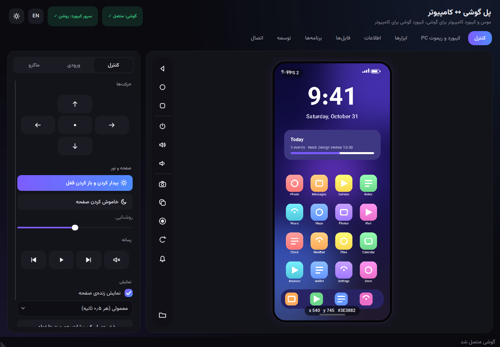 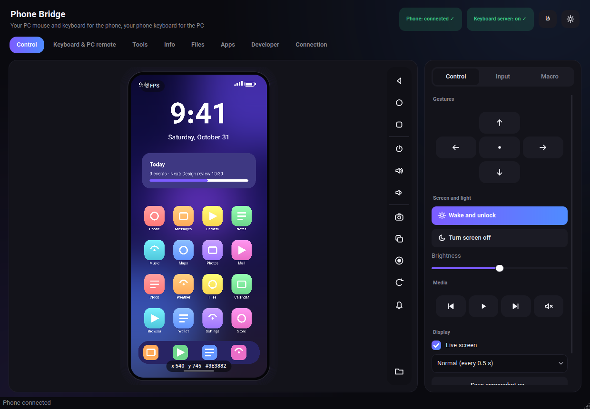</p>
<p align="center">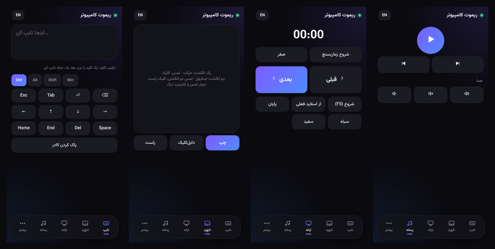</p>

<details>
<summary><b>تصاویر بیشتر</b> (هر تب)</summary>

| | |
|---|---|
| 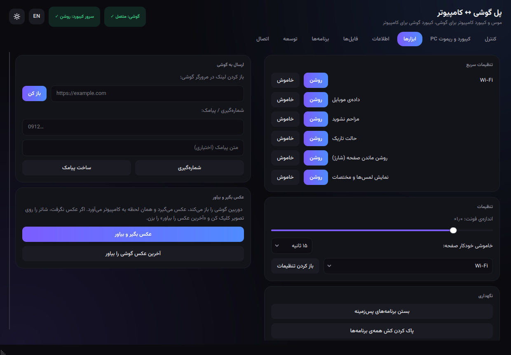 | 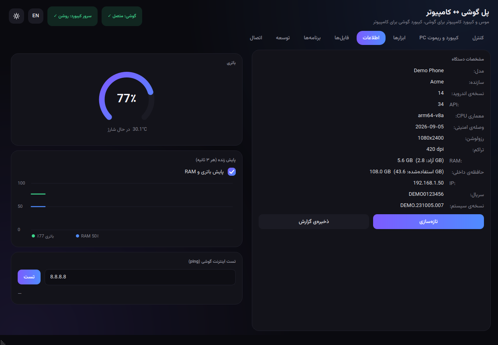 |
| 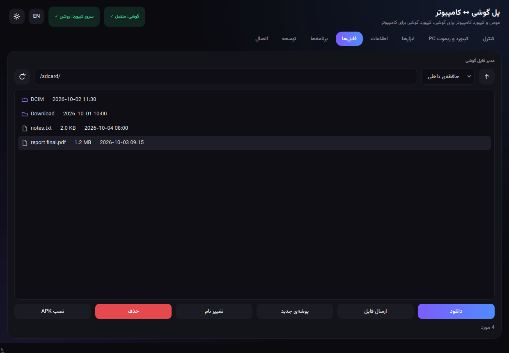 | 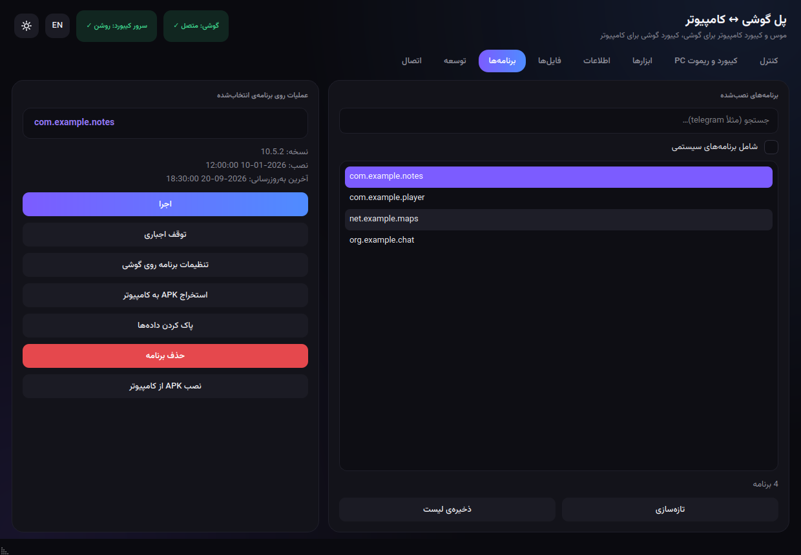 |
| 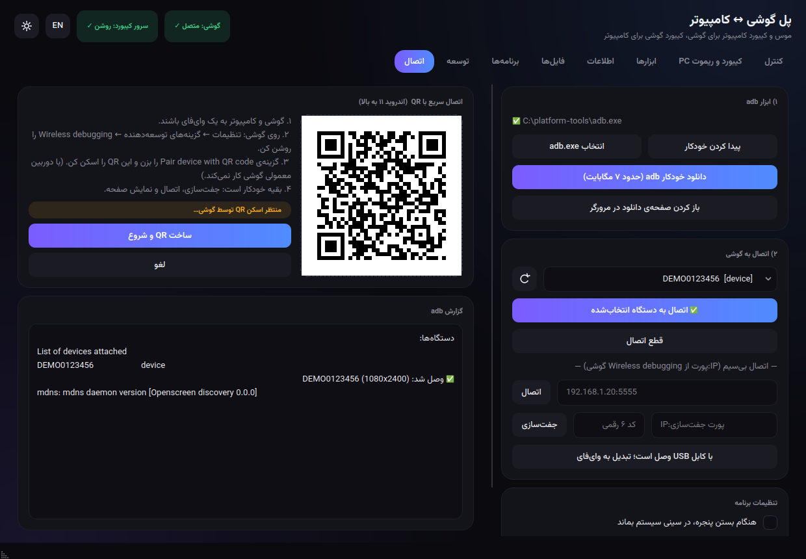 | 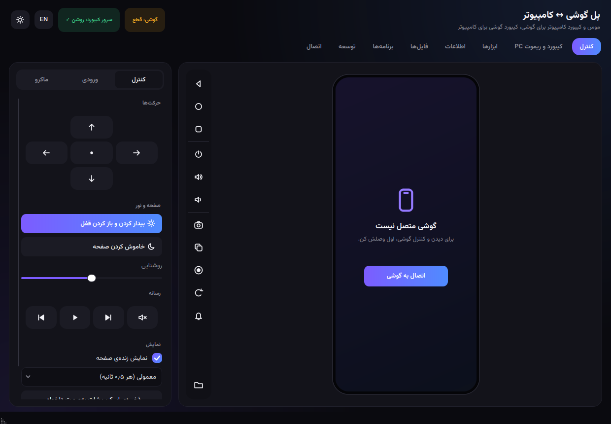 |
| 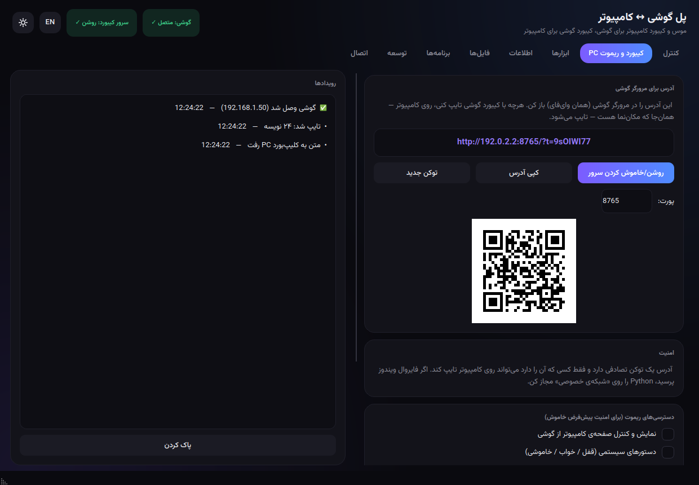 | 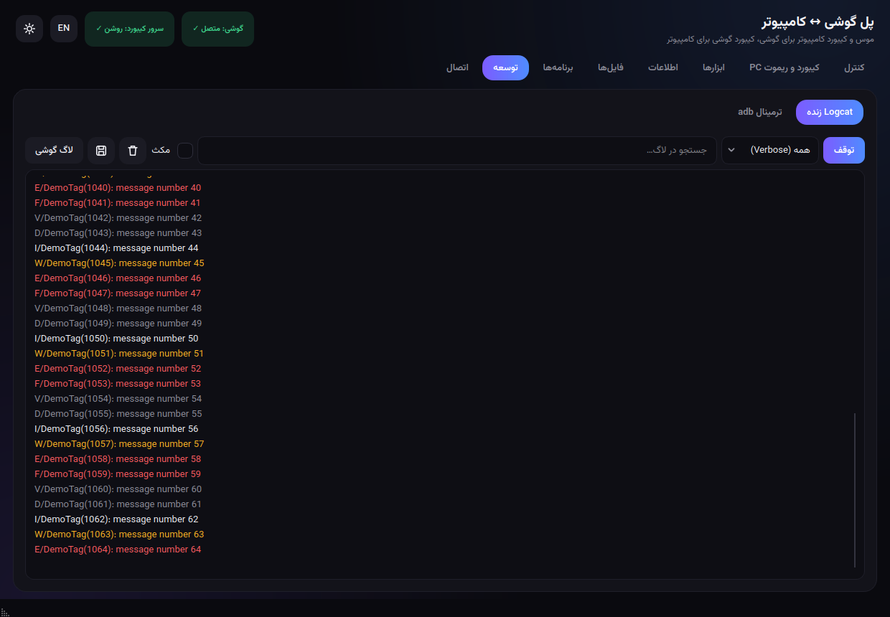 |

*تصاویر از خود برنامه و با یک گوشی شبیه‌سازی‌شده ساخته شده‌اند (`scripts/make_screenshots.py`).*

</details>

## شروع سریع

> **پیش‌نیازها:** پایتون **۳٫۱۰ یا بالاتر**، یک گوشی اندروید (۵ به بالا؛ برای QR و اتصال بی‌سیم **۱۱ به بالا**)، و برای حالت بی‌سیم، هر دو دستگاه روی یک شبکه. نیازی به نصب برنامه روی گوشی نیست.

**۱ · دریافت**

```bash
git clone https://github.com/YOUR_USERNAME/phone-bridge.git
cd phone-bridge
```

**۲ · اجرا**

| سیستم | دستور |
|---|---|
| **ویندوز** | روی `scripts\run.bat` دوبار کلیک کن (بار اول دو کتابخانه را نصب می‌کند) — یا: `py -m pip install -r requirements.txt` و بعد `py phone_bridge.py` |
| **لینوکس / مک** | `./scripts/run.sh` — یا: `pip install -r requirements.txt && python3 phone_bridge.py` |
| **pip** | `pip install .` و بعد `phone-bridge` |

**۳ · وصل کردن گوشی** (فقط یک‌بار)

1. روی گوشی: *تنظیمات ← درباره‌ی گوشی ←* هفت بار روی **Build number** بزن؛ بعد *گزینه‌های توسعه‌دهنده ←* **USB debugging** را روشن کن (برای وای‌فای، **Wireless debugging** را هم).
2. در برنامه، تب **اتصال** ← «دانلود خودکار adb» (یا `adb` خودت را انتخاب کن).
3. یا کابل را وصل کن و **اتصال** را بزن؛ یا «ساخت QR و شروع» را بزن و روی گوشی *Wireless debugging ← Pair device with QR code* را باز و اسکن کن.

تمام! تب **کنترل** حالا گوشی‌ات را نشان می‌دهد. راهنمای کامل: **[شروع سریع](docs/fa/getting-started.md)**.

**۴ · گوشی به‌عنوان ریموت** — تب **کیبورد و ریموت PC** را باز کن، آدرس نمایش‌داده‌شده را در مرورگر گوشی باز کن و تایپ یا تاچ‌پد را امتحان کن.

## وضعیت و محدودیت‌ها (صادقانه)

- پلتفرم اصلی **ویندوز ۱۰/۱۱** است. همه‌چیز روی **لینوکس** (CI بدون صفحه‌نمایش) هم تست می‌شود. **macOS تست نشده** (pynput آنجا مجوز Accessibility می‌خواهد).
- جریان اصلی (نمایش زنده، لمس/swipe/کلید، جفت‌سازی QR) را اولین کاربر روی گوشی واقعی تأیید کرده است. دسته‌ی بعدی امکانات (تنظیمات سریع، مدیر فایل و برنامه، ضبط صفحه، ماکرو، صفحه‌ی ریموت روی گوشی و …) با تست خودکار روی **adb شبیه‌سازی‌شده** پوشش داده شده؛ روی گوشی‌های واقعی بعضی دستورهای `adb shell` به نسخه‌ی اندروید و سازنده بستگی دارند (مثلاً شیائومی برای شبیه‌سازی لمس گزینه‌ی *USB debugging (Security settings)* را می‌خواهد). اگر روی گوشی تو رفتار فرق داشت، لطفاً Issue باز کن.
- تایپِ **متن غیرانگلیسی (مثل فارسی) داخل گوشی** از راه adb بدون برنامه‌ی کمکی ممکن نیست؛ [ADBKeyBoard](https://github.com/senzhk/ADBKeyBoard) را نصب و گزینه‌اش را تیک بزن. [راهنما](docs/fa/troubleshooting.md). جهت برعکس (کیبورد گوشی ← PC) فارسی را بی‌دردسر پشتیبانی می‌کند.
- دستورهای خاموشی (قفل/خواب/خاموش از صفحه‌ی گوشی) فقط روی ویندوز کار می‌کنند. نمایش صفحه، مانیتور اصلی را می‌گیرد.
- صفحه‌ی ریموت **HTTP ساده روی شبکه‌ی محلی** با یک توکن تصادفی است — فقط روی شبکه‌های قابل‌اعتماد استفاده کن. [نکات امنیتی](docs/fa/security.md)

## مستندات

| | فارسی | English |
|---|---|---|
| نصب، آماده‌سازی گوشی، اتصال (USB / QR / کد) | [شروع سریع](docs/fa/getting-started.md) | [getting-started](docs/en/getting-started.md) |
| توضیح همه‌ی تب‌ها، میانبرها و صفحه‌ی گوشی | [راهنمای استفاده](docs/fa/usage.md) | [usage](docs/en/usage.md) |
| فهرست کامل امکانات (۵۰+ امکان) | [امکانات](docs/fa/features.md) | [features](docs/en/features.md) |
| چیزی کار نمی‌کند؟ · پرسش‌های رایج | [رفع مشکل](docs/fa/troubleshooting.md) | [troubleshooting](docs/en/troubleshooting.md) |
| حریم خصوصی، دسترسی شبکه، مدل تهدید | [امنیت](docs/fa/security.md) | [security](docs/en/security.md) |
| برای توسعه‌دهندگان (انگلیسی) | [architecture](docs/dev/architecture.md) · [testing](docs/dev/testing.md) · [translations](docs/dev/translations.md) · [release](docs/dev/release.md) | |

## توسعه

```bash
pip install -r requirements-dev.txt
python -m pytest                                              # تست‌های واحد
xvfb-run -a python tests/gui_e2e.py --lang fa                 # تست سرتاسری GUI (لینوکس؛ --lang en هم)
cd tests/page && npm install && npm test                      # تست صفحه‌ی وب گوشی
ruff check .                                                  # lint
```

مشارکت خوشحالت می‌کند — **[CONTRIBUTING.md](CONTRIBUTING.md)** را ببین. کارهای شروع خوب: زبان‌های بیشتر، پورت به PySide6 (LGPL)، تست روی macOS، گزینه‌ی انتخاب آدرس شبکه برای سرور ریموت.

## مجوز و منابع

- کد: **[MIT](LICENSE)**.
- فونت **[وزیرمتن](https://github.com/rastikerdar/vazirmatn)** (مجوز SIL OFL 1.1) بار اول اجرا دانلود می‌شود و همراه پروژه نیست. `adb` («Android SDK Platform-Tools») فقط وقتی دکمه‌اش را بزنی از گوگل دانلود می‌شود.
- ساخته‌شده با [PyQt6](https://www.riverbankcomputing.com/software/pyqt/) (GPLv3 یا تجاری) و [pynput](https://github.com/moses-palmer/pynput) (LGPLv3). اگر **فایل اجرایی منتشر می‌کنی** (مثلاً با PyInstaller) [نکته‌ی مجوز](docs/dev/release.md#licensing-note-pyqt6-is-gpl) و [THIRD_PARTY_NOTICES.md](THIRD_PARTY_NOTICES.md) را بخوان.
- *Android* نشان تجاری Google LLC و *Windows* نشان تجاری Microsoft است. این پروژه وابسته به آن‌ها نیست و از طرفشان تأیید نشده است.

</div>
