<p align="center">
  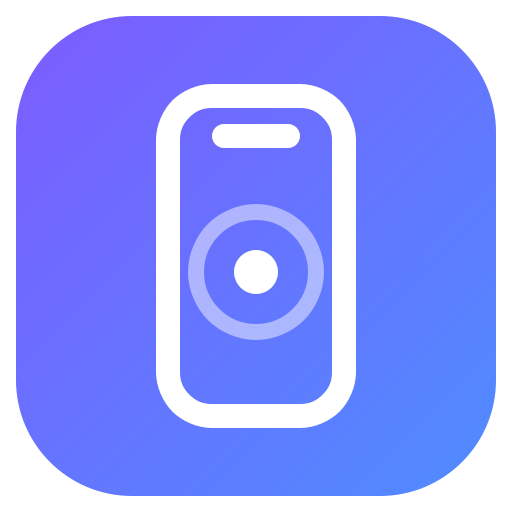
</p>

<h1 align="center">Phone Bridge</h1>

<p align="center">
  <b>Control your Android phone from your PC — and use your phone as a keyboard, trackpad and presenter remote for the PC.</b><br>
  Minimal, fast, bilingual (English · فارسی). No cloud, no account, no app to install on the phone.
</p>

<p align="center">
  <a href="https://github.com/YOUR_USERNAME/phone-bridge/actions/workflows/ci.yml"></a>
  
  
  
  
</p>

<p align="center">
  <a href="README.md"><b>English</b></a> · <a href="README.fa.md">فارسی</a> ·
  <a href="docs/en/getting-started.md">Getting started</a> ·
  <a href="docs/en/usage.md">User guide</a> ·
  <a href="docs/en/features.md">All 50+ features</a> ·
  <a href="docs/en/troubleshooting.md">Troubleshooting</a>
</p>

<p align="center">
  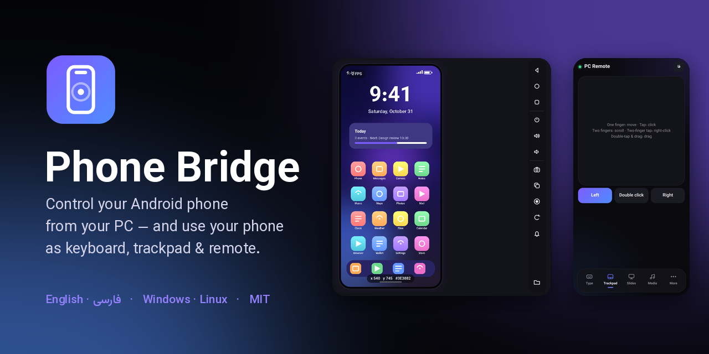
</p>

---

## What is it?

Phone Bridge is a single Python/Qt desktop app that connects your PC and your Android phone over your own network, in both directions:

| Direction | What you get | How it works |
|---|---|---|
| **PC → phone** | See the phone screen live, tap/swipe/scroll with your **mouse**, type with your **keyboard**, take screenshots, record the screen, manage files and apps, read logs … | [`adb`](https://developer.android.com/tools/adb) (Android Debug Bridge) over USB or Wi-Fi |
| **Phone → PC** | Use the phone as a **keyboard** (Persian included), a multi-touch **trackpad**, a **slide remote**, a media/volume remote, a shortcut pad, even a view of your PC screen | A tiny web page the app serves on your LAN — just open a link in the phone's browser, nothing to install |

> **Not a scrcpy replacement for video.** The mirror is screenshot-based (a few frames per second, depending on the phone and link), which is plenty for tapping, typing and managing the phone. If you need smooth video mirroring, run [scrcpy](https://github.com/Genymobile/scrcpy) next to it.

## Highlights

- **Minimal, modern UI** — dark & light themes, vector icons, Vazirmatn font, right-to-left aware. Switch **English ⇄ فارسی** with one click.
- **Connect in seconds** — USB cable, or **scan a QR code** from the phone's *Wireless debugging* screen (Android 11+). It finds the phone, pairs and connects by itself. Can even download `adb` for you.
- **Live phone view** with ripple feedback: click = tap, drag = swipe, wheel = scroll, right-click = Back, middle-click = Home, hold = long-press. Pixel coordinates + colour picker and FPS on the view.
- **Macros** — record taps/swipes/keys, replay at 0.5×–4×, loop, save/load as JSON.
- **Screenshots & screen recording** straight to your PC (shortcuts: `Ctrl+S`, `Ctrl+R`).
- **File manager, app manager, logcat, adb terminal**, device dashboard with battery gauge and live graph.
- **Phone-as-remote** web page: typing with sticky Ctrl/Alt/Shift/Win, a real multi-touch trackpad (2-finger scroll, 2-finger tap = right-click, double-tap-drag), slide remote with timer, media keys, 20 shortcuts, shared clipboard, PC screen view.
- **Safe by default** — random access token, remote screen sharing and power commands are **off** until you enable them. [Details](docs/en/security.md).
- **Tested** — 23 unit tests, 72 web-page tests, 70 GUI end-to-end checks per language, on Python 3.10 / 3.12 / 3.13. [Details](docs/dev/testing.md).

## Screenshots

<p align="center">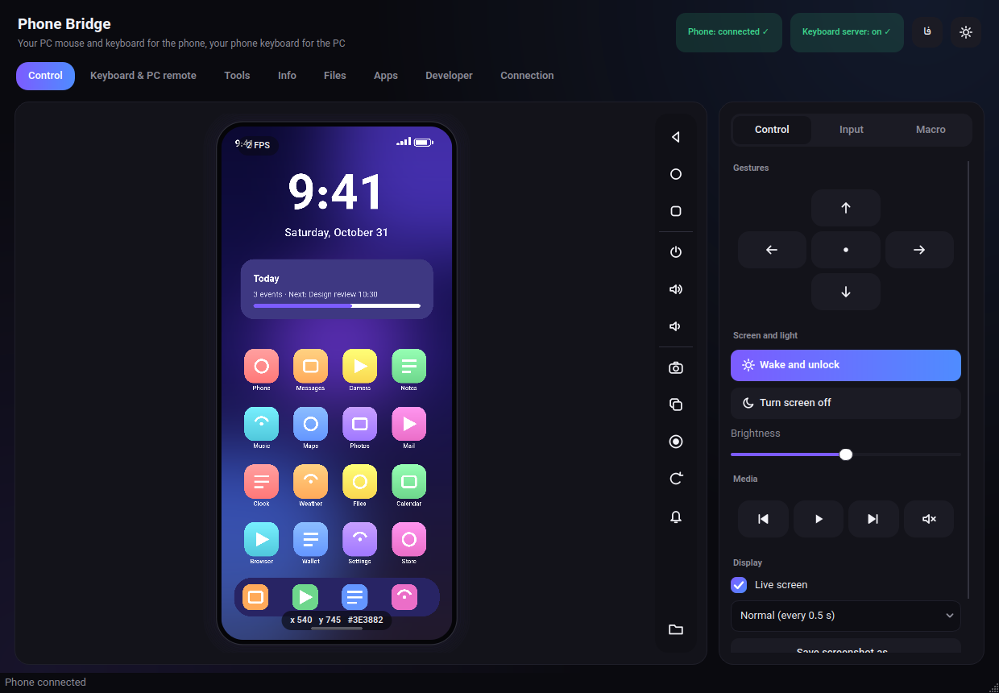 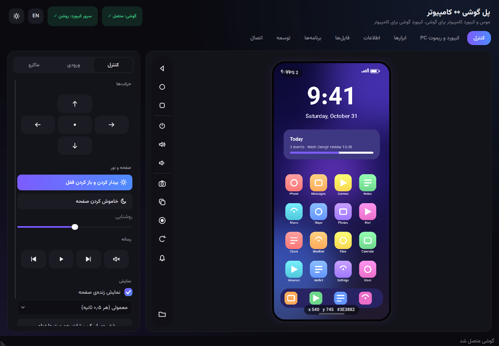</p>
<p align="center">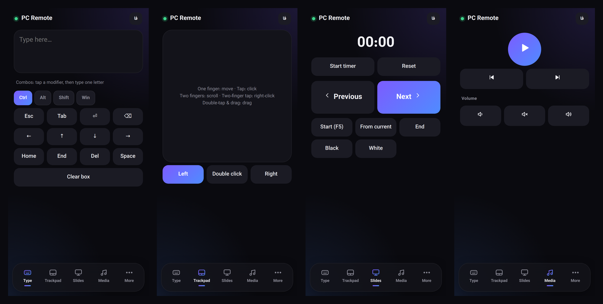</p>

<details>
<summary><b>More screenshots</b> (light theme, every tab)</summary>

| | |
|---|---|
| 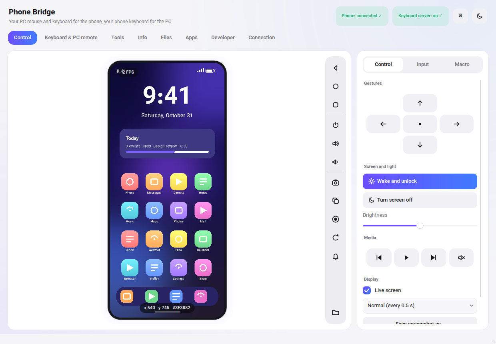 | 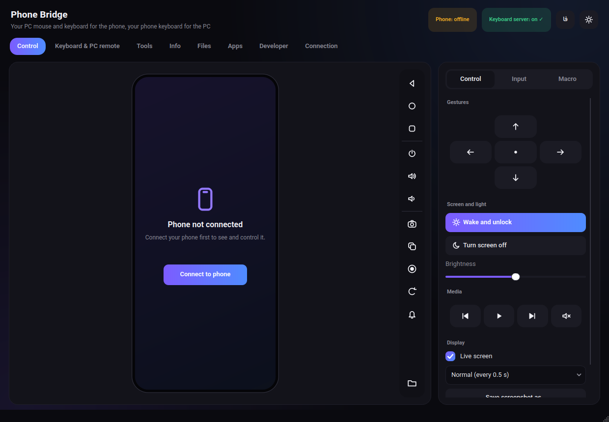 |
| 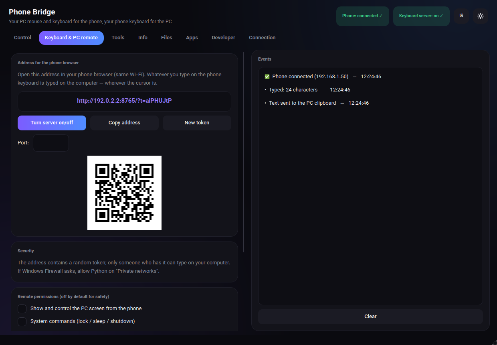 | 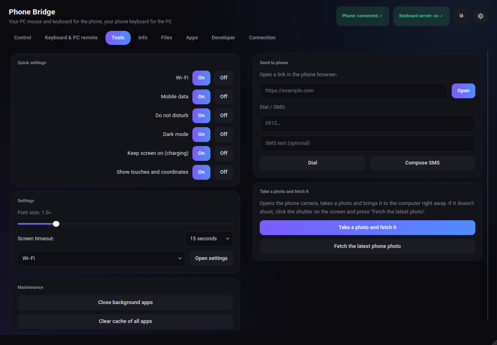 |
| 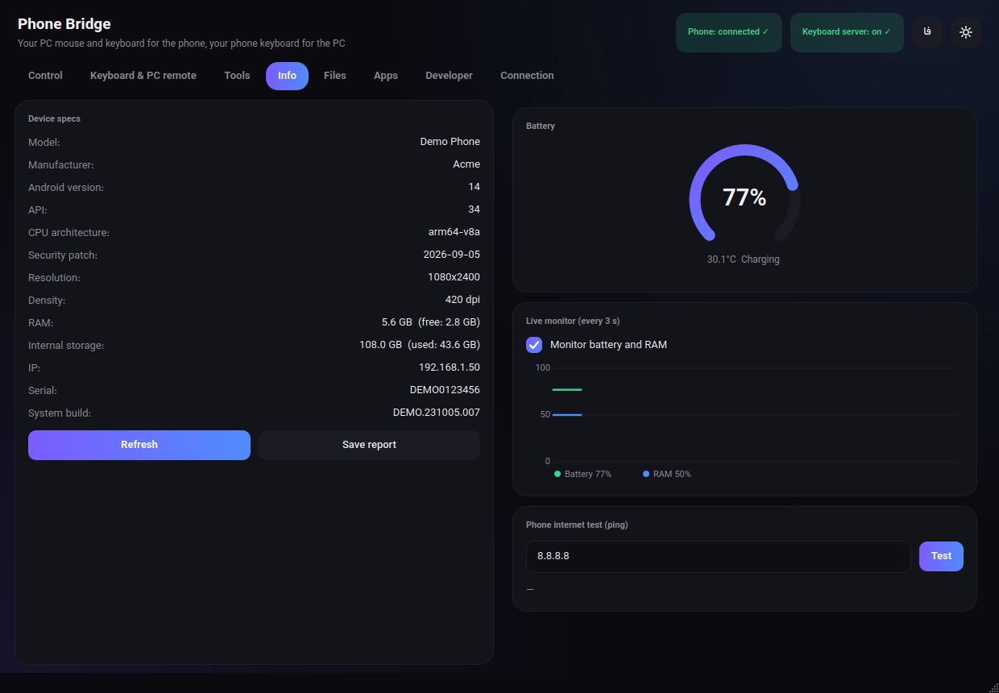 | 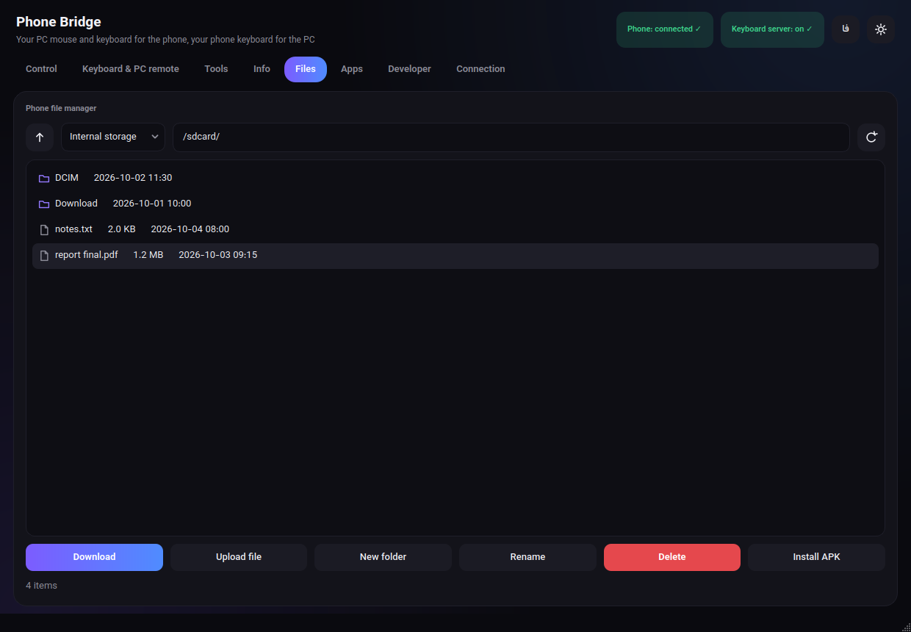 |
| 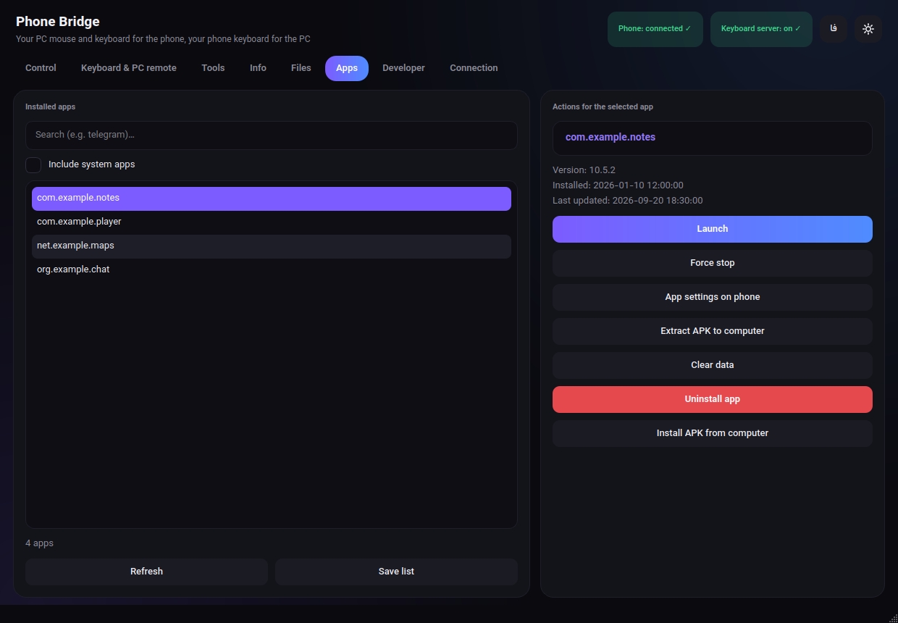 | 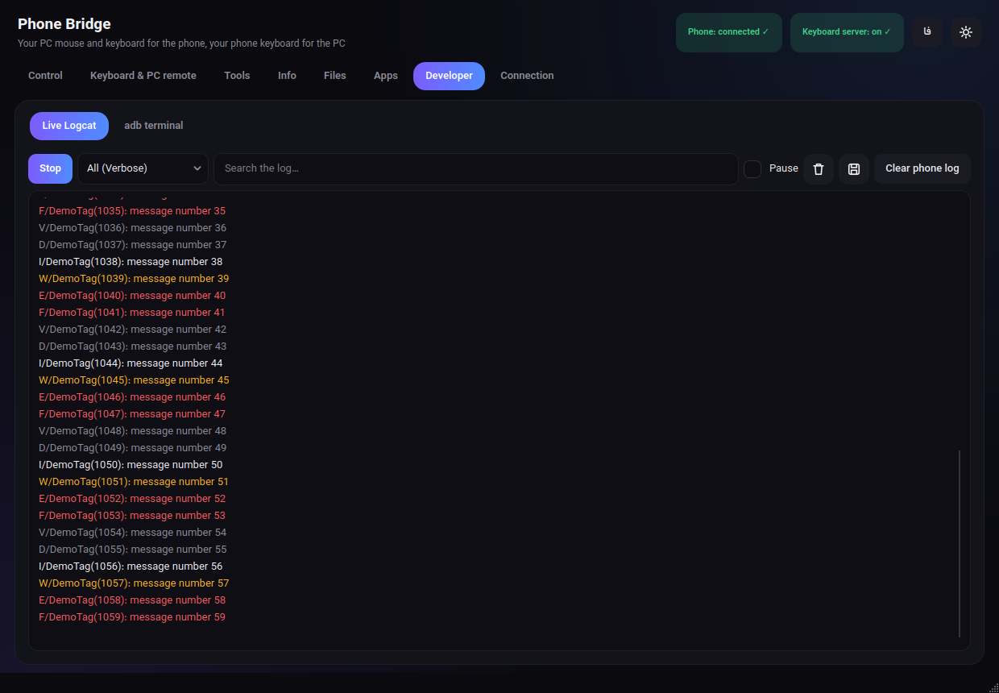 |
| 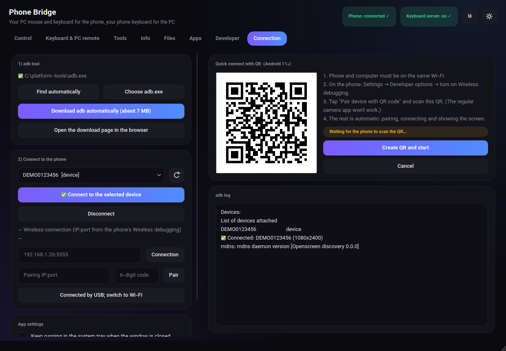 | 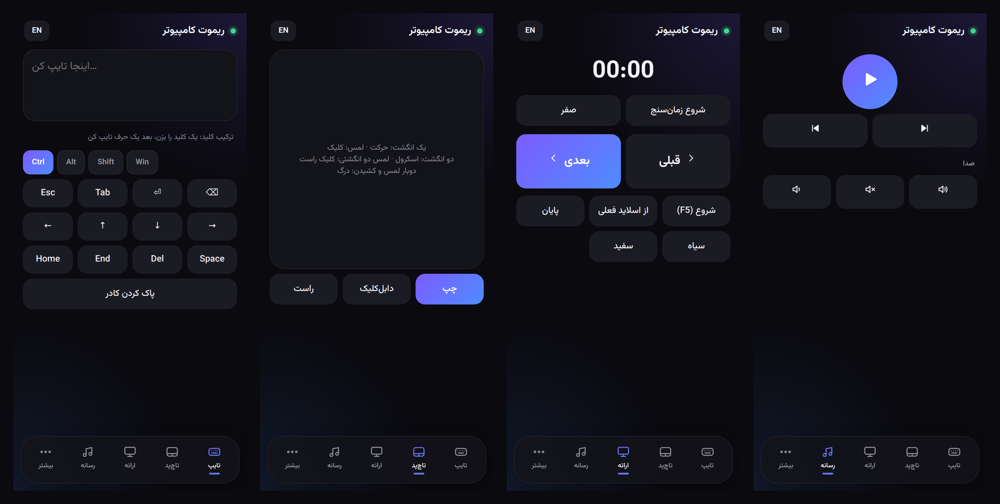 |

*Screenshots are generated from the real app against a simulated phone (`scripts/make_screenshots.py`).*

</details>

## Quick start

> **Requirements:** Python **3.10+**, an Android phone (5.0+; **11+** for QR/wireless pairing), and both devices on the same network for wireless use. No Android app is needed.

**1 · Get it**

```bash
git clone https://github.com/YOUR_USERNAME/phone-bridge.git
cd phone-bridge
```

**2 · Run it**

| OS | Command |
|---|---|
| **Windows** | double-click `scripts\run.bat` (installs the 2 dependencies on first run) — or: `py -m pip install -r requirements.txt` then `py phone_bridge.py` |
| **Linux / macOS** | `./scripts/run.sh` — or: `pip install -r requirements.txt && python3 phone_bridge.py` |
| **pip** | `pip install .` then `phone-bridge` |

**3 · Connect the phone** (once)

1. On the phone: *Settings → About phone →* tap **Build number** 7×, then *Developer options →* turn on **USB debugging** (and **Wireless debugging** for Wi-Fi).
2. In the app open the **Connection** tab → *Download adb automatically* (or point it to your own `adb`).
3. Either plug in the cable and press **Connect**, or press **Create QR and start**, then on the phone tap *Wireless debugging → Pair device with QR code* and scan.

That's it — the **Control** tab now shows your phone. Full walkthrough: **[Getting started](docs/en/getting-started.md)**.

**4 · Use the phone as a remote** — open the **Keyboard & PC remote** tab, scan/open the shown address in the phone's browser, and start typing or moving the trackpad.

## Status & honest limitations

- Primary platform is **Windows 10/11**. Everything is also exercised on **Linux** (headless CI). **macOS is untested** (pynput needs Accessibility permission there).
- The core flow (live view, tap/swipe/keys, QR pairing) was confirmed on a real phone by the first user. The later feature batch (quick settings, file/app managers, screen recording, macros, phone-side remote page …) is covered by automated tests against a **simulated adb**; on real phones some `adb shell` commands depend on the Android version and manufacturer (e.g. Xiaomi needs *USB debugging (Security settings)* for input injection). Please open an issue if something behaves differently on your device.
- Typing **non-ASCII text** (e.g. Persian) *into the phone* through adb is impossible without an IME helper; install [ADBKeyBoard](https://github.com/senzhk/ADBKeyBoard) and tick the option. See [troubleshooting](docs/en/troubleshooting.md#typing-persian-into-the-phone). The other direction (phone keyboard → PC) supports Persian out of the box.
- Power commands (lock/sleep/shutdown from the phone page) are Windows-only. Screen sharing captures the primary monitor.
- The remote page is plain **HTTP on your LAN** protected by a random token — use it on networks you trust. [Security notes](docs/en/security.md).

## Documentation

| | English | فارسی |
|---|---|---|
| Install, set up the phone, connect (USB / QR / code) | [getting-started](docs/en/getting-started.md) | [شروع سریع](docs/fa/getting-started.md) |
| Every tab, shortcut and the phone page, explained | [usage](docs/en/usage.md) | [راهنمای استفاده](docs/fa/usage.md) |
| The full feature list (50+ features) | [features](docs/en/features.md) | [امکانات](docs/fa/features.md) |
| Something doesn't work · FAQ | [troubleshooting](docs/en/troubleshooting.md) | [رفع مشکل](docs/fa/troubleshooting.md) |
| Privacy, network exposure, threat model | [security](docs/en/security.md) | [امنیت](docs/fa/security.md) |
| For developers | [architecture](docs/dev/architecture.md) · [testing](docs/dev/testing.md) · [translations](docs/dev/translations.md) · [release](docs/dev/release.md) | |

## Project layout

```
phone-bridge/
├── phone_bridge.py        # the whole app (single file by design — see docs/dev/architecture.md)
├── requirements.txt       # PyQt6, pynput
├── pyproject.toml         # `pip install .` → `phone-bridge` command
├── assets/                # icon.svg / .png / .ico
├── docs/                  # en/ fa/ (user docs) · dev/ (developer docs) · images/
├── scripts/               # run.bat · run.sh · build_windows.bat · make_screenshots.py · check_links.py · set_repo_owner.py
├── tests/                 # unit tests, GUI end-to-end test, phone-page jsdom tests, fake adb
└── .github/               # CI, release workflow, issue & PR templates
```

## Development

```bash
pip install -r requirements-dev.txt
python -m pytest                                              # unit tests (offscreen, ~1 s)
xvfb-run -a python tests/gui_e2e.py --lang fa                 # GUI end-to-end (Linux; use --lang en too)
cd tests/page && npm install && npm test                      # phone web-page tests (jsdom)
ruff check .                                                  # lint
```

Contributions are welcome — see **[CONTRIBUTING.md](CONTRIBUTING.md)**. Good first issues: more languages, a PySide6 port (LGPL), macOS testing, a bind-address option for the remote server.

## License & credits

- Code: **[MIT](LICENSE)**.
- UI font **[Vazirmatn](https://github.com/rastikerdar/vazirmatn)** (SIL OFL 1.1) is downloaded at first run, not bundled. `adb` ("Android SDK Platform-Tools") is downloaded from Google only when you press the button.
- Built with [PyQt6](https://www.riverbankcomputing.com/software/pyqt/) (GPLv3 / commercial) and [pynput](https://github.com/moses-palmer/pynput) (LGPLv3). If you **redistribute binaries** (e.g. a PyInstaller build) read the [licensing note](docs/dev/release.md#licensing-note-pyqt6-is-gpl) and [THIRD_PARTY_NOTICES.md](THIRD_PARTY_NOTICES.md).
- *Android* is a trademark of Google LLC; *Windows* of Microsoft. This project is not affiliated with or endorsed by them.
