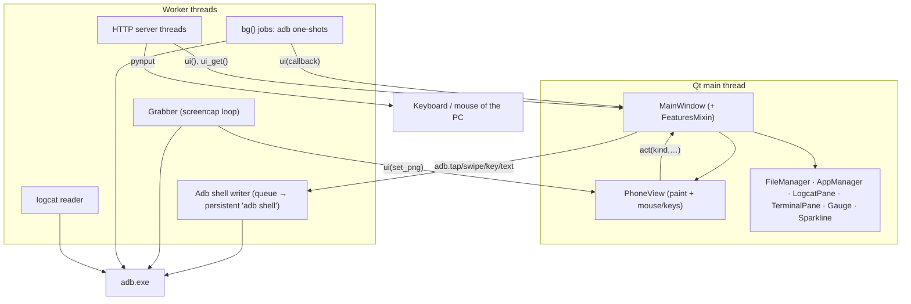
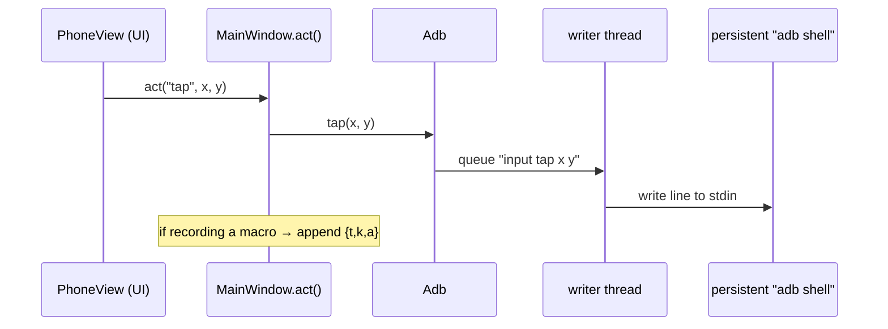

# Architecture

[← Docs index](../README.md) · Developer documentation (English)

Phone Bridge is one Python file, `phone_bridge.py` (~4,500 lines, of which ~400 are the English translation table). It is a deliberate choice: you can copy one file and run it. The cost is a long file, so this page is the map.

- [Big picture](#big-picture)
- [Threads & the UI bridge](#threads--the-ui-bridge)
- [File map](#file-map)
- [PC → phone: the adb layer](#pc--phone-the-adb-layer)
- [The phone view](#the-phone-view)
- [Phone → PC: the remote server and page](#phone--pc-the-remote-server-and-page)
- [QR pairing](#qr-pairing)
- [Theming & icons](#theming--icons)
- [i18n](#i18n)
- [Data, config, fonts](#data-config-fonts)
- [Design decisions & trade-offs](#design-decisions--trade-offs)
- [Roadmap for restructuring](#roadmap-for-restructuring)

---

## Big picture



Two independent halves share the window:

| Half | Entry points | Talks to |
|---|---|---|
| **PC → phone** | `Adb`, `Grabber`, `PhoneView`, all tabs | `adb` executable (USB / Wi-Fi) |
| **Phone → PC** | `PhoneKeyboardServer`, `PAGE` | the phone's browser; the PC through `pynput` |

## Threads & the UI bridge

Qt widgets may only be touched from the main thread. Everything slow (adb calls, screencap, HTTP handling, logcat reading) runs on plain `threading.Thread`s, and results come back through one tiny helper:

```python
class Bus(QObject):               # lives in the main thread
    call = pyqtSignal(object)     # emit(callable) from ANY thread → runs it on the main thread
BUS = Bus();  ui = BUS.call.emit  # usage: ui(lambda: label.setText("done"))
```

Helpers built on it:

- `MainWindow.bg(fn, cb)` — run `fn` in a thread; call `cb(result_or_exception)` on the UI thread.
- `ui_get(fn)` — run `fn` on the UI thread **and wait** for its return value (the HTTP handler uses it to read the PC clipboard).
- `Grabber` — a thread looping `screencap` → `ui(view.set_png)`.

Rules of thumb for contributors: never create/modify a widget from `bg()` work; always wrap the UI part in `ui(...)` or use the callback; never block the UI thread on adb (always `bg`).

## File map

(Line numbers drift; search for the names.)

| Region | Contents |
|---|---|
| top | module docstring, `__version__`, **i18n** (`LANG`, `EN` table, `tr()`), `_data_dir()`/`APP_DIR`, config load/save, **fonts** (`setup_fonts`, `fetch_fonts`) |
| themes | `THEMES` (dark/light palettes), `QSS` template with `@key@` placeholders, `build_qss`, `make_icons` (check / arrow PNGs for QSS) |
| bridge | `Bus`, `ui` |
| adb | `find_adb`, `adb_cmd`, `parse_mdns`, `Adb`, `Grabber` |
| web | `PAGE` (the whole phone UI as one HTML string), `PhoneKeyboardServer`, `local_ip` |
| QR | `qr_matrix` (byte mode, ECC-M, versions 1–10, mask selection) + `qr_pixmap` — no third-party QR library |
| view | `ANDROID_KEYS`, `PhoneView` |
| UI kit | `mk_btn`, `mk_card`, `mk_label`, `ltr`, vector icons (`ICONS`, `make_icon`, `icon_round`, `app_icon`), `Segmented`, `Root` (aurora background), `scroll_wrap`, `Gauge`, `Sparkline`, `HistLine` |
| tabs | `FileManager`, `AppManager`, `LogcatPane`, `TerminalPane` |
| features | `FeaturesMixin` — most window-level behaviour: icon toolbar & control page, macros, recording, tools, info, dev tab, drag & drop, remote-permission cards, frame grabber for PC screen, tray, watchdog/auto-reconnect |
| window | `MainWindow` — header, tabs, theme/language switching, connection logic, QR pairing flow, server toggles |
| entry | `_restart_argv`, `parse_args`, `main` |

## PC → phone: the adb layer



- **Input** (tap / swipe / key / text) goes through *one long-lived* `adb shell` process fed by a queue. That removes ~100 ms of process-spawn latency per event. `Adb.text()` escapes spaces as `%s` and single-quotes the payload; non-ASCII goes through `text_unicode()` (ADBKeyBoard broadcast).
- **Anything that returns output** (`Adb.sh`, `pull`, `push`, `install`, `screencap`) uses a fresh one-shot process via `adb_cmd()`/`subprocess.run` with a timeout. `ADB_MDNS_OPENSCREEN=1` is set in the environment so Windows adb uses its built-in mDNS.
- **Screenshots**: `adb exec-out screencap -p` returns a PNG over a binary-safe channel (works on Windows, no CRLF mangling). The PNG's size gives the real orientation.
- `NOWIN` (`CREATE_NO_WINDOW`) keeps console windows from flashing on Windows.
- `find_adb` order: saved path → `PATH` → `./platform-tools` → `ANDROID_HOME` → `%LOCALAPPDATA%\Android\Sdk` → a few common folders. `download_adb` unzips Google's zip into the data folder.
- Macros store *kind + args* (`tap x y`, `swipe x1 y1 x2 y2 ms`, `key code`, `text s`) in `{"t": seconds, "k": kind, "a": [...]}` and replay them by calling the same `Adb` methods from a thread.

Every user action funnels through `MainWindow.act(kind, *args)` so macro recording sees it; direct `adb.run()` is for fire-and-forget system commands that shouldn't be recorded.

## The phone view

`PhoneView` is a custom `QWidget` (≈250 lines):

- `set_png(bytes)` → `QImage` → `QPixmap`; remembers the QImage for pixel lookups (HUD colour picker) and the frame timestamps for FPS.
- `screen_rect()` fits the phone's aspect ratio into the widget; `to_phone(pos)` maps widget → phone pixels (clamped).
- Mouse: press/release timing decides tap vs long-press vs swipe (`<8 px` movement = tap, `>0.6 s` = long-press; swipe duration follows drag time, clamped 80–1500 ms). Wheel → a swipe of 16 % of the screen height. Right/middle → Back/Home.
- Paint: soft accent glow, bezel, rounded-clip screen, ripples (a 16 ms timer runs only while ripples exist), drag line, HUD pills; an empty state with a *Connect* button when not connected.
- Keyboard: special keys via `ANDROID_KEYS`, printable text via `MainWindow.send_text_to_phone`.

## Phone → PC: the remote server and page

`PhoneKeyboardServer.start(port)` builds a `ThreadingHTTPServer` on `0.0.0.0` and serves:

| Method & path | Auth | Purpose |
|---|---|---|
| `GET /?t=` | token | the page (`PAGE` with `__T__`, `__LANG__`, `__DIR__` substituted) |
| `GET /f/Vazirmatn-*.ttf?t=` | token | font files from `<data>/fonts` (name whitelist: `vazir*.ttf`, no path components) |
| `GET /state?t=` | token | `{"screen": bool, "system": bool}` — which opt-in features are on |
| `GET /inbox?t=` | token | `{"id": n, "text": "…"}` — message sent from the PC |
| `GET /pcclip?t=` | token | `{"text": "…"}` — PC clipboard (read via `ui_get`) |
| `GET /screen?t=` | token + permission | latest JPEG of the primary monitor (grabbed on the UI thread by a timer, only while someone is polling) |
| `POST /e?t=` | token | one JSON event (below) |

Event schema (`POST /e`):

| `type` | fields | effect |
|---|---|---|
| `text` | `back:int`, `add:str` | `back` × Backspace, then type `add` (Unicode OK) |
| `key` | `key` ∈ enter, backspace, tab, esc, left/right/up/down, space, delete, home, end, f1–f12, ctrl, alt, shift, win | tap that key |
| `combo` | `keys:[…]` (≤6; named keys or single chars) | hold all but the last, tap the last |
| `media` | `k` ∈ play, next, prev, vol_up, vol_down, mute | media key |
| `move` | `dx`, `dy` | relative mouse move |
| `click` | `b` ∈ left/right, `n` ∈ 1–2 | click / double-click |
| `scroll` | `d:int` (>0 = down) | wheel |
| `mouse` | `act` ∈ down/up | press / release left button (drag) |
| `abs` | `fx`, `fy` ∈ 0–1, `act` ∈ move/click/rclick | absolute position on the primary monitor — **only if screen sharing is allowed and a frame exists** |
| `clip` | `text` | set the PC clipboard (via `ui`) |
| `power` | `cmd` ∈ lock, sleep, shutdown, restart, cancel | **only if system commands are allowed** (Windows); fixed command table, never a shell string |

`PAGE` is a self-contained HTML/CSS/JS string (no external resources, so it works offline): bottom navigation, SVG icons from a JS map, a bilingual `L` table (`fa`/`en`), CSS variables for dark/light, a multi-touch trackpad state machine, and a `send()` queue that preserves event order (`chain = chain.then(fetch…)`). Typed text is sent as a **diff** (common prefix kept; `back` + `add`) so autocorrect, composition and Persian work.

jsdom tests (`tests/page`) execute this page with a mocked `fetch` and assert the exact events produced by each gesture.

## QR pairing

```mermaid
sequenceDiagram
    participant App as Phone Bridge
    participant Ph as Phone (Wireless debugging)
    App->>App: name = "studio-" + 10 random, pw = 12 random
    App->>Ph: shows QR "WIFI:T:ADB;S:<name>;P:<pw>;;"
    Ph->>Ph: user scans → advertises _adb-tls-pairing._tcp named <name>
    loop every 1.2 s, ≤150 s
        App->>App: adb mdns services → find <name>
    end
    App->>Ph: adb pair <ip:port> <pw>
    loop ≤30 s
        App->>App: adb mdns services → _adb-tls-connect on same IP
    end
    App->>Ph: adb connect <ip:port> → Adb(serial)
```

`qr_matrix()` is a compact, dependency-free QR encoder (byte mode, ECC level M, versions 1–10, best of 8 masks by penalty) — enough for pairing strings and URLs. Tests decode its output with OpenCV.

## Theming & icons

- `THEMES["dark"|"light"]` are flat dicts of colours; `CUR` points at the active one. `QSS` is one big stylesheet with `@name@` placeholders replaced by `build_qss()` — add a colour once, use it everywhere.
- Widgets that paint themselves (`PhoneView`, `Gauge`, `Sparkline`, `Root`) read `CUR[...]` in `paintEvent`.
- Icons are **vector-drawn at runtime** (`ICONS` dict of small `QPainter` functions → `make_icon(name, colour, size)` rendered at 3× for crispness). `apply_theme()` re-renders every registered icon button (`_icon_btns`, `ICON_ROUNDS`).
- Custom `objectName`s drive QSS: `Card`, `Stage`, `Panel`, `Toolbar`, `Tool`, `Round`, `Dpad`, `Seg`/`SegBtn`, `Pill` (with a `state` property), `Caption`, …

## i18n

All UI text is wrapped in `tr("فارسی متن")`; the **Persian string is the key**, and `EN` maps it to English. Language is a process-wide constant chosen at start (`LANG`), and switching it restarts the process — no live retranslation machinery, no stale labels. See **[translations](translations.md)**.

## Data, config, fonts

`_data_dir()` picks, in order: `$PHONE_BRIDGE_HOME` → exe folder (PyInstaller) → `~/.phone-bridge` (pip-installed) → the script folder. It holds `phone_bridge_config.json` (`theme`, `lang`, `adb_path`, `last_ip`, `port`, `tray`, `reconnect`), `fonts/`, `platform-tools/`. Writing is best-effort (`save_cfg` swallows errors).

Fonts: `setup_fonts()` registers any `Vazir*.ttf` it finds; `fetch_fonts()` (background thread, only if none found) tries several CDNs/raw GitHub and keeps files that start with a TTF magic number and are >50 KB.

## Design decisions & trade-offs

| Decision | Why | Cost |
|---|---|---|
| Single file | zero-friction to copy/run/audit | long file; harder to review diffs |
| Screenshot-based mirror | no phone-side agent, works everywhere adb works | low FPS; can't beat scrcpy |
| One persistent `adb shell` for input | latency | must handle a dead shell (watchdog polls `proc.poll()`) |
| Plain HTTP + URL token | works in any browser without certificates | no TLS ([security](../en/security.md)) |
| Page served as one string | no static-file handling, offline-safe | big string in Python (tests cover it) |
| Restart to switch language | simplest correct behaviour (layout direction, every label) | ~1 s flash |
| Own QR encoder | no extra dependency (also needed offline on first run) | limited to versions 1–10 |
| Vector icons in code | theme-aware, crisp, no assets | more code than shipping SVGs |

## Roadmap for restructuring

If the file grows, a natural split (each step independently testable):

```
phone_bridge/
  __init__.py  __main__.py
  i18n.py        # tr, EN (+ more languages as data files)
  config.py      # data dir, cfg, fonts
  adb.py         # find_adb, adb_cmd, Adb, Grabber, mdns parsing
  qr.py          # qr_matrix / qr_pixmap
  server.py      # PhoneKeyboardServer + web/index.html as a real file
  ui/            # theme, icons, widgets, tabs, window
```

Moving `PAGE` into a real `index.html` (+ `page.js`) would make the web UI easier to edit; the jsdom tests would then load the file directly.
