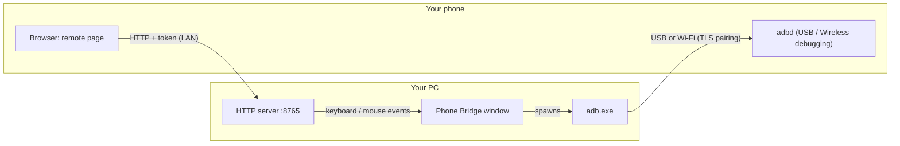

# Security & privacy

[← Docs index](../README.md) · **English** · [فارسی](../fa/security.md)

Phone Bridge gives one device control over another, so it's worth knowing exactly what it exposes. This page is written from the code, not from marketing: if something here is wrong, please [report it](../../SECURITY.md).

**TL;DR** — No telemetry, no accounts, no cloud. Phone→PC control is a small HTTP server on your LAN guarded by a random token; anyone who holds the link can type and click on your PC, so treat the link like a password and use it on networks you trust. Dangerous extras (PC screen, power commands) are off until you switch them on, every start.

- [What talks to what](#what-talks-to-what)
- [The remote server (phone → PC)](#the-remote-server-phone--pc)
- [adb (PC → phone)](#adb-pc--phone)
- [Threat model](#threat-model)
- [Data stored and network connections](#data-stored-and-network-connections)
- [Hardening checklist](#hardening-checklist)

---

## What talks to what

Nothing leaves your local network, except the optional downloads listed [below](#data-stored-and-network-connections).

## The remote server (phone → PC)

**What it is.** A `ThreadingHTTPServer` started by the app (toggle in the *Keyboard & PC remote* tab), listening on **all interfaces**, default port **8765**.

**Authentication.** Every request — page, events, fonts, images, clipboard — must carry the query parameter `t=<token>`, compared with a constant-time check. The token is `secrets.token_urlsafe(6)` (≈48 random bits) and is **regenerated at every start** and by *New token*. Wrong tokens get `403`; rejected page loads are also logged (with the client IP) in the *Events* list.

**What a valid token can do** — be clear-eyed about this:

| Capability | Always on? |
|---|---|
| Type any text and press any key combination in whichever window has focus (this is equivalent to **running commands as you**, e.g. `Win+R`) | yes |
| Move/click/scroll the mouse; press-and-drag | yes |
| Press media keys | yes |
| **Read** your PC clipboard (`/pcclip`) and **write** it | yes |
| Show your **primary monitor** and click on it | **no** — opt-in checkbox, off at every start |
| Lock / sleep / shut down / restart (Windows only; fixed command list, no arbitrary commands) | **no** — opt-in checkbox, off at every start |

**What it does not do.** No file transfer through the page, no arbitrary shell, no access to anything outside the above. Typed *text* is never written to the log (only its length).

**Known limitations (v1.0)** — contributions welcome:

- **Plain HTTP, no TLS.** Someone sniffing the Wi-Fi (or on a hostile network) can read the token and what you type.
- **No rate limiting / lockout.** The token space is large (48 bits) but there is no throttling.
- **Listens on every interface**, not just the Wi-Fi/LAN you intend. Use the firewall (below).
- The token travels in the URL: it appears in browser history, and in screenshots of the address or QR.

## adb (PC → phone)

- *USB debugging* and *Wireless debugging* let the authorized computer **do almost anything** on the phone: read/write files, install apps, inject input, read the screen. That's inherent to `adb`; Phone Bridge just drives it.
- USB: Android asks you to authorize each computer's RSA key (*Always allow* stores it). Revoke under *Developer options → Revoke USB debugging authorizations*.
- Wireless: pairing uses a one-time code (or the one-time password inside the QR); afterwards the connection is mutually authenticated and encrypted by `adbd`. **Do not publish a screenshot of a QR/pairing code while it is active.** Turn *Wireless debugging* off when not in use.
- The **adb terminal** and **Logcat** run arbitrary commands/streams on your own phone by design.
- User-supplied strings (URLs, phone numbers, SMS text, package names, file paths) are shell-quoted before being sent to the phone's shell.
- Destructive actions (delete files, clear data, uninstall) ask for confirmation.

## Threat model

| Who | Can they do harm? |
|---|---|
| Someone on your Wi-Fi who **doesn't** know the link | They can see the port is open and get `403`. Guessing the token is impractical, but there's no lockout — another reason to use trusted networks and the firewall. |
| Someone who **sees the link/QR** (shoulder-surfing, screenshot, shared screen) | Full keyboard/mouse/clipboard control of your PC until you press **New token** or quit the app. |
| Someone **sniffing** your network traffic | Can read the token and typed text (no TLS). Don't use it on public Wi-Fi. |
| A **website** you visit | Cross-site requests can't succeed without the token, which they can't know. |
| Someone with **physical access to your unlocked phone** | Can open the page history/bookmark → control your PC until the token changes. Lock your phone; the token changes on each app start. |
| Malware **already on your PC** | Out of scope (it could do everything directly). |
| A malicious **adb server / fake adb** on your PATH | Out of scope; the app runs whichever `adb` you pointed it at. Download Platform-Tools from Google (the built-in button does) and keep PATH clean. |

## Data stored and network connections

**On disk** (data folder — see [Getting started](getting-started.md#command-line-options--data-folder)):

| File | Content | Sensitive? |
|---|---|---|
| `phone_bridge_config.json` | theme, language, adb path, last `IP:port`, server port, tray/reconnect switches | no secrets |
| `fonts/` | Vazirmatn `.ttf` files | no |
| `platform-tools/` | adb, if you pressed *Download* | no |
| `Pictures/PhoneBridge`, `Videos/PhoneBridge` | screenshots, recordings, fetched photos — **your phone's content** | **yes** |
| OS temp `phone_bridge_open/` | files you double-clicked in the file manager (opened locally) | possibly |

The access token and the QR's pairing password live **only in memory**.

**Network connections the app itself makes:**

| To | When | Why |
|---|---|---|
| your phone (adb) / your LAN | whenever connected | the feature itself |
| `cdn.jsdelivr.net`, `fastly.jsdelivr.net`, `gcore.jsdelivr.net`, `unpkg.com`, `raw.githubusercontent.com` | first run, only if fonts are missing | download Vazirmatn (HTTPS; only files that look like TTFs and are >50 KB are kept) |
| `dl.google.com` | only when you press *Download adb automatically* | Google's official Platform-Tools zip (HTTPS) |
| a "UDP connect" to `8.8.8.8:80` | when showing the server address | to learn your LAN IP — the OS picks the interface; **no packet is sent** |
| *Ping test* target (default `8.8.8.8`) | only when you press *Test* | the **phone** pings it |

No analytics, crash reporting or update checks.

## Hardening checklist

- Use the remote page only on networks you trust; never on public Wi-Fi.
- In Windows Firewall allow Python/`phone_bridge` on **Private** networks only.
- Keep **PC screen** and **System commands** switched off unless you're using them (they reset to off at each start anyway).
- Turn the server **off** when you're not using the phone page.
- Press **New token** after anyone may have seen the link/QR.
- Lock your phone; remove the remote page from browser history/bookmarks if the phone is shared.
- Turn *Wireless debugging* off when done; revoke USB-debugging authorizations on phones you give away.
- Keep Python, PyQt6 and Platform-Tools up to date.

Found a vulnerability? Please follow **[SECURITY.md](../../SECURITY.md)** — report privately first.
