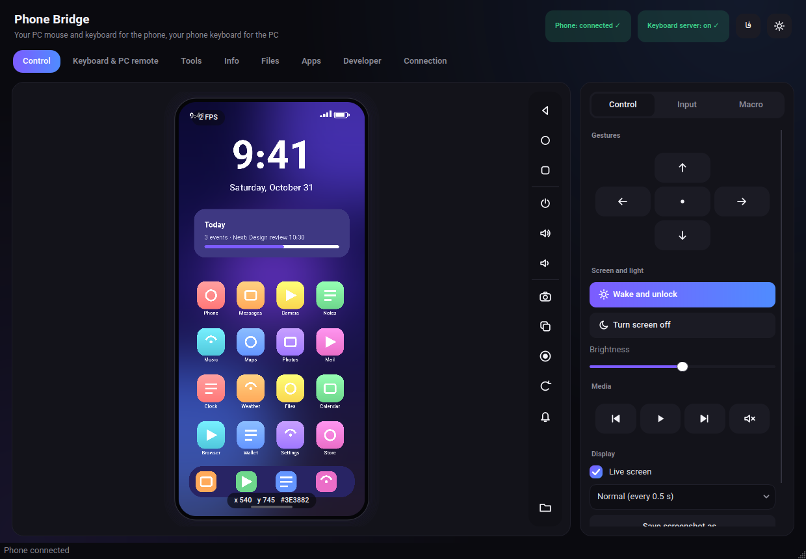
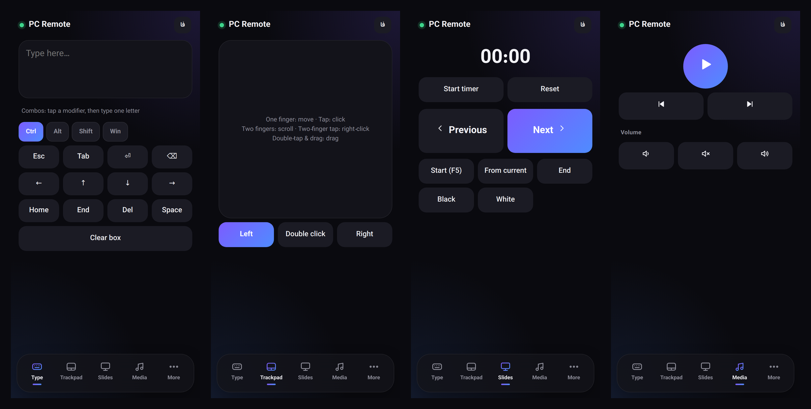
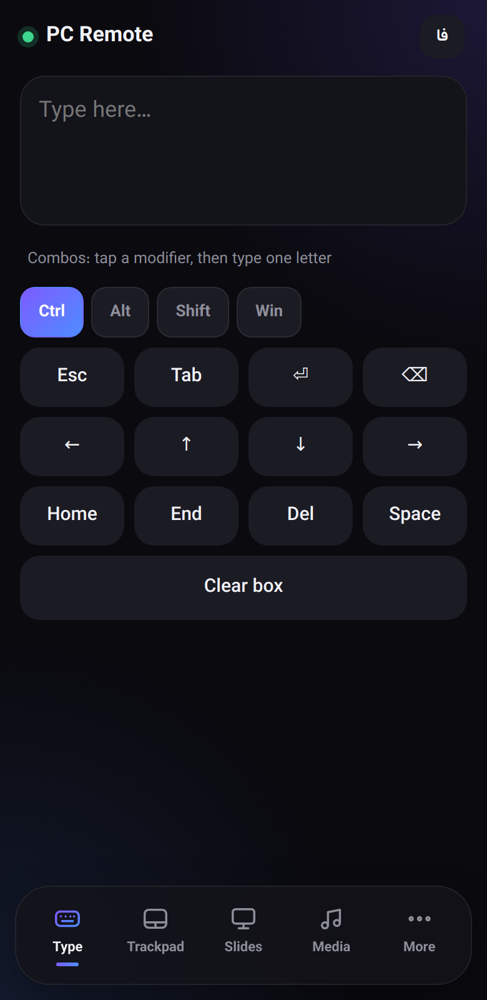
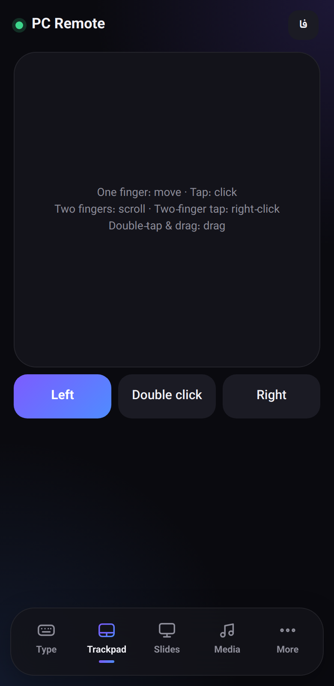
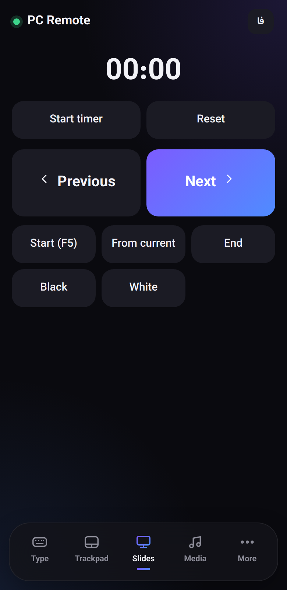
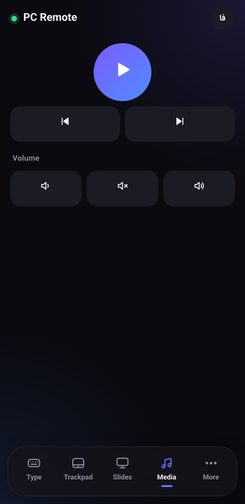
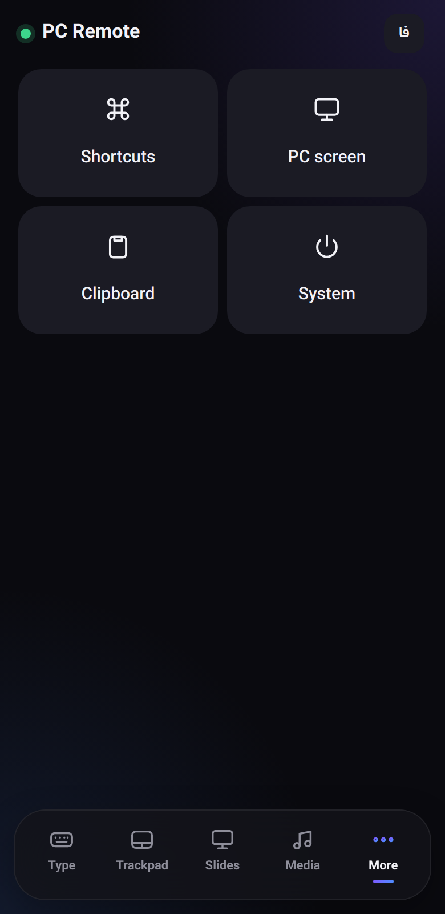
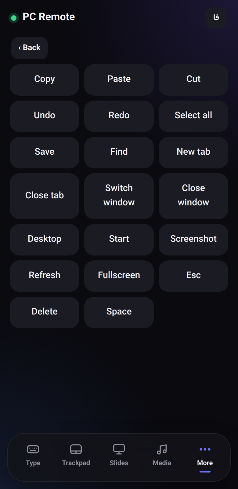
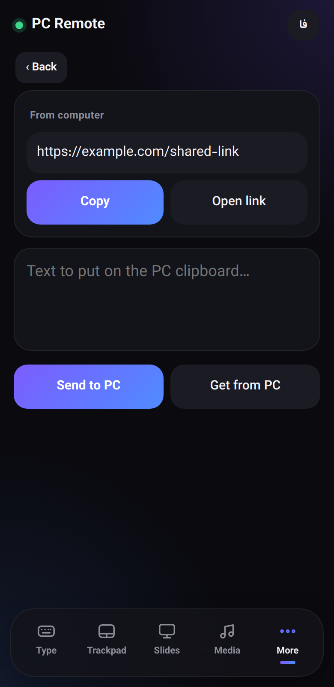
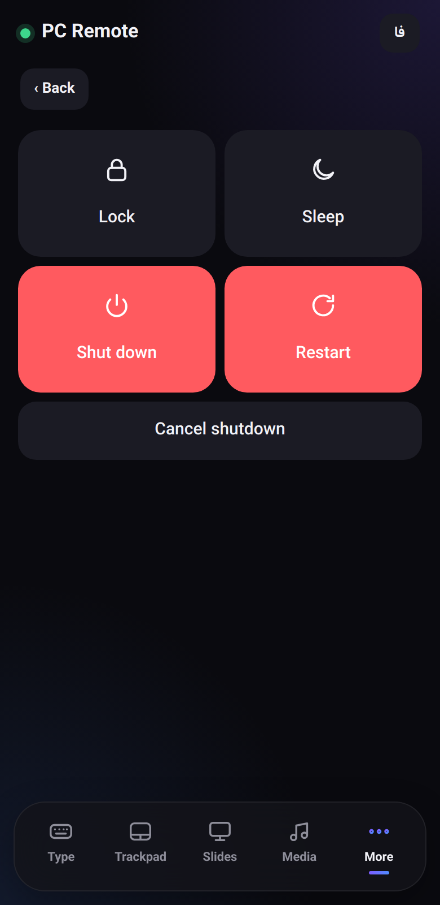

# User guide

[← Docs index](../README.md) · **English** · [فارسی](../fa/usage.md)

A tour of every part of the app. New here? Do **[Getting started](getting-started.md)** first.

- [The window](#the-window)
- [Control tab](#control-tab) — mirror, mouse, toolbar, panel, macros, shortcuts
- [Keyboard & PC remote tab](#keyboard--pc-remote-tab) — the server
- [The phone remote page](#the-phone-remote-page)
- [Tools tab](#tools-tab)
- [Info tab](#info-tab)
- [Files tab](#files-tab)
- [Apps tab](#apps-tab)
- [Developer tab](#developer-tab)
- [Connection tab](#connection-tab)
- [Keyboard shortcuts](#keyboard-shortcuts)

---

## The window

Top bar: app name · two status pills (**Phone: connected ✓**, **Keyboard server: on ✓**) · **EN / فا** language button · sun/moon theme button.

- **Theme** — dark or light, remembered.
- **Language** — English or Persian. Switching restarts the app (about a second) so every text and the whole layout flips between left-to-right and right-to-left. Your phone connection is re-established automatically.
- Eight tabs: Control · Keyboard & PC remote · Tools · Info · Files · Apps · Developer · Connection.
- The status bar (bottom) shows short messages ("Screenshot saved: …").

---

## Control tab

### The phone view

A live picture of the phone screen (refreshed a few times per second). Mouse mapping:

| Mouse | On the phone |
|---|---|
| **Left click** | tap |
| **Hold** left button > 0.6 s | long-press |
| **Drag** | swipe (speed follows how fast you drag) |
| **Wheel** | scroll |
| **Right click** | Back |
| **Middle click** | Home |
| **Keyboard** (view focused) | types text; `Backspace`, `Enter`, `Esc`(=Back), `Tab`, arrows, `Delete`, `Home`, `End`, `PgUp/PgDn` are sent as keys |

A **ripple** shows where you tapped; while dragging a line follows the pointer. Hover to read `x y #colour` of the pixel (handy for UI testing). The top-left pill is the measured **FPS**. If the picture is all black the app tells you why (screen off/locked, or a protected screen such as a banking app).

Orientation is detected from the screenshot itself, so landscape works.

### Toolbar (vertical, next to the view)

| Icon | Action |
|---|---|
| ◁ ○ □ | Back · Home · Recent apps |
| power, volume ± | Screen on/off · Volume up · Volume down |
| camera | **Quick screenshot** — saved to `Pictures/PhoneBridge` with a timestamp |
| copy | Copy the current picture to the clipboard |
| record | **Record the screen** (up to 3 min, runs on the phone, then copied to `Videos/PhoneBridge`). Click again to stop. The icon turns red while recording |
| rotate | Rotate the phone 90° each click (turns auto-rotate off) |
| bell | Pull down the notification shade |
| folder | Open the images folder |

### Side panel

A segmented control switches between three pages.

**Control**

- *Gestures* — a D-pad: ↑ scrolls down, ↓ scrolls up, ← / → swipe; the centre dot double-taps the middle of the screen.
- *Wake and unlock* — wakes the phone and swipes up (enter a PIN yourself if you have one). *Turn screen off* — sleep.
- *Brightness* — slider (switches to manual brightness).
- *Media* — previous · play/pause · next · mute (media keys of the phone).
- *Display* — **Live screen** on/off; refresh speed *Fast (0.25 s) / Normal (0.5 s) / Low power (1 s)*; **Save screenshot as…** (asks where).

**Input**

- *Type on the phone* — a text box; **Enter** or **Send** types it into the focused field on the phone. ASCII works everywhere; for Persian/Unicode tick **Persian/Unicode via ADBKeyboard** (needs the [ADBKeyBoard](https://github.com/senzhk/ADBKeyBoard) IME on the phone — see [troubleshooting](troubleshooting.md#typing-persian-into-the-phone)).
- Short reminders of the mouse mapping.

**Macro**

1. **Start recording**, perform taps/swipes/keys on the phone view (button says *Stop*), stop.
2. Choose **Repeat** (`∞` = until you press Stop) and speed (0.5× … 4×), press **Play macro**.
3. **Save / Open** store the macro as a JSON file (a list of `{t, k, a}` — time, kind, arguments) that you can edit by hand.

Macros replay raw coordinates, so they work best on the same screen resolution and app state.

---

## Keyboard & PC remote tab

This tab controls the small web server that powers the [phone remote page](#the-phone-remote-page).

- **Address** — `http://<your-LAN-IP>:<port>/?t=<token>`. Open it in the phone browser, or scan the QR code below.
- **Turn server on/off**, **Copy address**, **New token** (invalidates the old link — use it if the link leaked), **Port** (default 8765; change, then toggle the server).
- **Events** — a log (“Phone connected (192.168.1.50)”, “Typed: 12 characters”, rejected requests). Typed *text itself is never logged*, only its length.
- **Remote permissions** *(off by default, reset to off at every start)*
  - *Show and control the PC screen from the phone* — lets the page stream your **primary monitor** and click on it.
  - *System commands (lock / sleep / shutdown)* — enables the *System* page (Windows only).
- **Send text or a link from the computer to the phone** — type here, press **Send to the phone page**: it appears on the phone page (*More → Clipboard*) with Copy / Open-link buttons, and the phone vibrates.
- **Security** — reminder; see [security](security.md).

The first time, Windows Firewall will ask about Python — allow **Private networks**.

---

## The phone remote page

Opened in the phone's browser; works in dark or light mode (follows the phone), has an **EN / فا** switch of its own, uses Vazirmatn (served from your PC, so no internet is needed), and vibrates lightly on taps.

Bottom bar: **Type · Trackpad · Slides · Media · More**.

<b>Every page of the phone remote (screenshots)</b>

<table>
<tr>
  <td align="center" width="25%"> Type</td>
  <td align="center" width="25%"> Trackpad</td>
  <td align="center" width="25%"> Slides</td>
  <td align="center" width="25%"> Media</td>
</tr>
<tr>
  <td align="center" width="25%"> More</td>
  <td align="center" width="25%"> Shortcuts</td>
  <td align="center" width="25%"> Clipboard</td>
  <td align="center" width="25%"> System</td>
</tr>
</table>

| Page | What it does |
|---|---|
| **Type** | A big text box: whatever you type with the phone's keyboard appears on the PC where the cursor is. Handles autocorrect and **Persian** correctly (it sends the *difference* between old and new text). Below: **sticky modifiers** *Ctrl / Alt / Shift / Win* — tap one, then type a single letter to send a combo like `Ctrl+C`. Key buttons: Esc, Tab, Enter, Backspace, arrows, Home, End, Del, Space. |
| **Trackpad** | A real multi-touch pad. **One finger** = move (with acceleration) · **tap** = left click · **two-finger tap** = right click · **two-finger drag** = scroll (natural direction) · **tap, then touch and drag** = press-and-drag (select text, move windows). Buttons: Left, Double click, Right. |
| **Slides** | Big **Previous / Next** (arrow keys), **Start (F5)**, **From current (Shift+F5)**, **End (Esc)**, **Black (B)**, **White (W)** — works with PowerPoint, LibreOffice, Google Slides, PDF viewers. Includes a **timer** (start/stop/reset). |
| **Media** | Play/pause, previous/next track, volume down/up, mute (system media keys on the PC). |
| **More → Shortcuts** | 20 one-tap shortcuts: Copy, Paste, Cut, Undo, Redo, Select all, Save, Find, New tab, Close tab, Switch window (Alt+Tab), Close window (Alt+F4), Desktop (Win+D), Start, Screenshot (Win+Shift+S), Refresh, Fullscreen, Esc, Delete, Space. |
| **More → PC screen** | Live view of your PC's main monitor (needs the permission above). Tap = click, hold = right-click, drag = move the mouse; extra buttons for double-click and scroll. |
| **More → Clipboard** | Send text from the phone **to the PC clipboard**, fetch the **PC clipboard** into the box, and see messages sent from the PC. |
| **More → System** | Lock · Sleep · Shut down (30 s) · Restart (30 s) · Cancel shutdown. Each dangerous action asks for confirmation. Needs the permission above, Windows only. |

---

## Tools tab

Quick actions that run `adb shell` commands. *Results can vary by Android version and manufacturer*; the status bar shows the result.

| Card | Items |
|---|---|
| **Quick settings** | Wi-Fi · Mobile data · Do not disturb · Dark mode · Keep screen on while charging · Show touches + pointer coordinates (developer overlay) — each with **On / Off** |
| **Settings** | Font size slider (0.8×–2.0×) · Screen timeout (15 s … 30 min) · **Open settings** shortcuts (Wi-Fi, Bluetooth, Display, Sound, Battery, Storage, Apps, Developer options, Accessibility, Location, Language, About phone) |
| **Maintenance** | Close background apps · Clear cache of all apps *(limited on some phones)* |
| **Send to phone** | Open a **link** in the phone's browser · open the **dialer** with a number · compose an **SMS** (you press send on the phone) |
| **Take a photo and fetch it** | Opens the camera, presses the shutter key, waits for a new file in `DCIM/Camera` and copies it to `Pictures/PhoneBridge`. If your camera ignores the key, tap the shutter on the phone view, then press **Fetch the latest phone photo**. |

---

## Info tab

- **Device specs** — model, manufacturer, Android version/API, CPU architecture, security patch, resolution, density, RAM (total/free), internal storage (total/used), IP, serial, build. **Save report** writes a text file.
- **Battery** — gauge with percentage, temperature and charging state.
- **Live monitor** — battery % and RAM-used % every 3 s (last 60 samples).
- **Phone internet test** — runs `ping` *on the phone* against a host (default `8.8.8.8`; change it if that address is blocked where you live) and reports average/min/max latency.

---

## Files tab

A phone file manager.

- Path bar, **Up**, quick locations (Internal storage, Download, DCIM, Pictures, Documents, Movies, Music, Root), refresh.
- Folders first, then files with size and date. **Double-click** a folder to open; double-click a file to **download it to a temp folder and open it** with your PC's default app.
- Buttons: **Download** (to a folder you choose; multi-select and folders work) · **Upload file** · **New folder** · **Rename** · **Delete** (asks) · **Install APK**.
- **Drag & drop**: drop files anywhere on the app window → they are copied to the phone's `Download` folder; **`.apk` files are installed** instead.

---

## Apps tab

- Third-party apps by default; tick **Include system apps** for all. Live search box.
- Select an app to see its version and install/update dates, then: **Launch** · **Force stop** · **App settings on phone** · **Extract APK to computer** (all split APKs) · **Clear data** (asks) · **Uninstall app** (asks) · **Install APK from computer**.
- **Save list** writes all package names to a text file.

---

## Developer tab

- **Logcat** — live stream. Level filter (All / Debug+ / Info+ / Warning+ / Error+), text search, **Pause**, clear view, **save to file**, **clear the phone's log** (`logcat -c`). Lines are colour-coded.
- **adb terminal** — type any `adb shell` command; `↑ / ↓` browse history. Quick buttons: Specs, Battery, Apps, Network, Processes, Storage, Foreground app. Commands time out after 60 s, so use `top -n 1`, not bare `top`.

---

## Connection tab

Described step by step in **[Getting started](getting-started.md#3-connect--pick-one-method)**. Extra things here:

- **adb log** — raw output of every connection attempt; attach it to bug reports.
- **App settings**
  - *Keep running in the system tray when the window is closed* — closing the window hides it; use the tray icon menu → **Quit** to exit.
  - *Reconnect automatically when the phone drops* — checks every 5 s; for Wi-Fi it runs `adb connect` to the last address again. On by default.

---

## Keyboard shortcuts

Active inside the app window:

| Keys | Action |
|---|---|
| `Alt + ←` | Back |
| `Alt + Home` | Home |
| `Alt + ↓` | Recent apps |
| `Ctrl + S` | Quick screenshot |
| `Ctrl + R` | Start / stop screen recording |
| `Ctrl + Shift + C` | Copy the current phone picture |

Next: **[Feature list](features.md)** · **[Troubleshooting](troubleshooting.md)**
