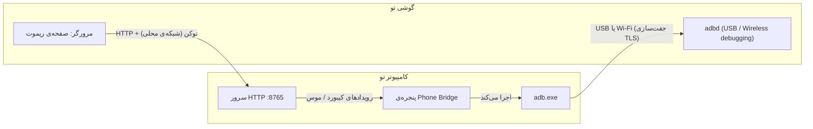

# امنیت و حریم خصوصی

[← فهرست مستندات](../README.md) · [English](../en/security.md) · **فارسی**

Phone Bridge به یک دستگاه کنترل دستگاه دیگر را می‌دهد، پس بهتر است دقیقاً بدانی چه چیزی را در معرض می‌گذارد. این صفحه از روی کد نوشته شده، نه تبلیغات: اگر چیزی اشتباه است، لطفاً [گزارشش کن](../../SECURITY.md).

**خلاصه** — بدون تله‌متری، بدون حساب کاربری، بدون ابر. کنترل گوشی←PC یک سرور HTTP کوچک روی شبکه‌ی محلی است که با یک توکن تصادفی محافظت می‌شود؛ هرکس لینک را داشته باشد می‌تواند روی کامپیوتر تو تایپ و کلیک کند، پس لینک را مثل رمز عبور حساب کن و فقط روی شبکه‌های قابل‌اعتماد استفاده کن. قابلیت‌های خطرناک (صفحه‌ی PC، دستورهای خاموشی) تا وقتی روشنشان نکنی خاموش‌اند — و در هر بار اجرا دوباره خاموش می‌شوند.

- [چه چیزی با چه چیزی حرف می‌زند](#چه-چیزی-با-چه-چیزی-حرف-میزند)
- [سرور ریموت (گوشی ← PC)](#سرور-ریموت-گوشی--pc)
- [adb (PC ← گوشی)](#adb-pc--گوشی)
- [مدل تهدید](#مدل-تهدید)
- [داده‌های ذخیره‌شده و اتصال‌های شبکه](#دادههای-ذخیرهشده-و-اتصالهای-شبکه)
- [فهرست تقویت امنیت](#فهرست-تقویت-امنیت)

---

## چه چیزی با چه چیزی حرف می‌زند

هیچ چیز از شبکه‌ی محلی‌ات بیرون نمی‌رود، جز دانلودهای اختیاری که [پایین](#دادههای-ذخیرهشده-و-اتصالهای-شبکه) آمده.

## سرور ریموت (گوشی ← PC)

**چیست.** یک `ThreadingHTTPServer` که برنامه راه می‌اندازد (کلید در تب *کیبورد و ریموت PC*)، روی **همه‌ی رابط‌های شبکه** گوش می‌دهد، پورت پیش‌فرض **۸۷۶۵**.

**احراز هویت.** هر درخواست — صفحه، رویدادها، فونت‌ها، تصاویر، کلیپ‌بورد — باید پارامتر `t=<توکن>` را داشته باشد که با مقایسه‌ی زمان‌ثابت بررسی می‌شود. توکن `secrets.token_urlsafe(6)` (حدود ۴۸ بیت تصادفی) است و **در هر بار اجرا** و با *توکن جدید* دوباره ساخته می‌شود. توکن غلط `403` می‌گیرد؛ بارگذاری‌های ردشده‌ی صفحه با IP کلاینت در فهرست *رویدادها* ثبت هم می‌شوند.

**توکن معتبر چه کارهایی می‌تواند بکند** — واقع‌بینانه نگاه کن:

| توانایی | همیشه فعال؟ |
|---|---|
| تایپ هر متن و فشردن هر ترکیب کلید در پنجره‌ای که فوکوس دارد (این معادل **اجرای فرمان به‌جای تو** است، مثلاً با `Win+R`) | بله |
| حرکت/کلیک/اسکرول موس؛ فشردن و کشیدن | بله |
| فشردن کلیدهای رسانه | بله |
| **خواندن** کلیپ‌بورد PC (`/pcclip`) و **نوشتن** در آن | بله |
| نمایش **مانیتور اصلی** و کلیک روی آن | **نه** — گزینه‌ی اختیاری، در هر اجرا خاموش |
| قفل / خواب / خاموشی / ری‌استارت (فقط ویندوز؛ فهرست ثابت فرمان‌ها، نه فرمان دلخواه) | **نه** — گزینه‌ی اختیاری، در هر اجرا خاموش |

**چه کارهایی نمی‌کند.** انتقال فایل از راه صفحه ندارد، shell دلخواه ندارد، دسترسی به چیزی بیرون از موارد بالا ندارد. *متن* تایپ‌شده هرگز در گزارش نوشته نمی‌شود (فقط طولش).

**محدودیت‌های شناخته‌شده (نسخه‌ی ۱٫۰)** — مشارکت خوش‌آمد است:

- **HTTP ساده، بدون TLS.** کسی که ترافیک وای‌فای را شنود کند (یا روی شبکه‌ی خصمانه) توکن و متن تایپ‌شده را می‌خواند.
- **بدون محدودیت تعداد تلاش / قفل.** فضای توکن بزرگ است (۴۸ بیت) ولی سرعت‌گیری ندارد.
- روی **همه‌ی رابط‌ها** گوش می‌دهد، نه فقط وای‌فای/LAN مورد نظرت. از فایروال استفاده کن (پایین).
- توکن در URL است: در تاریخچه‌ی مرورگر و در اسکرین‌شات آدرس یا QR دیده می‌شود.

## adb (PC ← گوشی)

- *USB debugging* و *Wireless debugging* به کامپیوتر مجاز اجازه می‌دهند **تقریباً هر کاری** روی گوشی بکند: خواندن/نوشتن فایل، نصب برنامه، تزریق ورودی، خواندن صفحه. این ذات `adb` است؛ Phone Bridge فقط آن را به کار می‌گیرد.
- USB: اندروید برای کلید RSA هر کامپیوتر از تو مجوز می‌گیرد (*Always allow* ذخیره‌اش می‌کند). لغو: *Developer options ← Revoke USB debugging authorizations*.
- بی‌سیم: جفت‌سازی با یک کد یک‌بارمصرف (یا رمز یک‌بارمصرف درون QR) انجام می‌شود؛ بعدش اتصال را `adbd` دوطرفه احراز هویت و رمزنگاری می‌کند. **تا وقتی QR/کد جفت‌سازی فعال است اسکرین‌شاتش را منتشر نکن.** وقتی کارت تمام شد *Wireless debugging* را خاموش کن.
- **ترمینال adb** و **Logcat** به‌دلخواه روی گوشی خودت فرمان/جریان اجرا می‌کنند.
- رشته‌هایی که کاربر می‌دهد (URL، شماره‌تلفن، متن پیامک، نام بسته، مسیر فایل) قبل از فرستادن به shell گوشی نقل‌قول امن می‌شوند.
- کارهای مخرب (حذف فایل، پاک کردن داده، حذف برنامه) تأیید می‌گیرند.

## مدل تهدید

| چه کسی | آیا می‌تواند آسیب بزند؟ |
|---|---|
| کسی روی وای‌فای تو که لینک را **نمی‌داند** | می‌بیند پورت باز است و `403` می‌گیرد. حدس توکن عملی نیست، ولی قفل ندارد — دلیل دیگری برای شبکه‌ی قابل‌اعتماد و فایروال. |
| کسی که **لینک/QR را می‌بیند** (نگاه از پشت سر، اسکرین‌شات، اشتراک صفحه) | تا وقتی **توکن جدید** نزنی یا برنامه را نبندی، کنترل کامل کیبورد/موس/کلیپ‌بورد کامپیوترت را دارد. |
| کسی که ترافیک شبکه را **شنود** می‌کند | توکن و متن تایپ‌شده را می‌خواند (TLS نیست). روی وای‌فای عمومی استفاده نکن. |
| یک **وب‌سایت** که می‌بینی | درخواست‌های بین‌سایتی بدون توکن موفق نمی‌شوند و توکن را نمی‌داند. |
| کسی با **دسترسی فیزیکی به گوشی بازِ تو** | می‌تواند از تاریخچه/بوکمارک صفحه را باز کند ← تا تغییر توکن کامپیوترت را کنترل کند. گوشی را قفل کن؛ توکن با هر اجرای برنامه عوض می‌شود. |
| بدافزارِ **از قبل روی PC** | خارج از دامنه (خودش مستقیماً همه‌کاری می‌تواند). |
| یک **adb جعلی** در PATH | خارج از دامنه؛ برنامه همان `adb`ای را اجرا می‌کند که نشانش داده‌ای. Platform-Tools را از گوگل بگیر (دکمه‌ی داخل برنامه همین کار را می‌کند) و PATH را تمیز نگه دار. |

## داده‌های ذخیره‌شده و اتصال‌های شبکه

**روی دیسک** (پوشه‌ی داده — [شروع سریع](getting-started.md#گزینههای-خط-فرمان-و-پوشهی-داده)):

| فایل | محتوا | حساس؟ |
|---|---|---|
| `phone_bridge_config.json` | تم، زبان، مسیر adb، آخرین `IP:port`، پورت سرور، کلیدهای سینی/اتصال مجدد | رمزی ندارد |
| `fonts/` | فایل‌های `.ttf` وزیرمتن | خیر |
| `platform-tools/` | adb، اگر دانلود را زده باشی | خیر |
| `Pictures/PhoneBridge`، `Videos/PhoneBridge` | اسکرین‌شات‌ها، ضبط‌ها، عکس‌های آورده‌شده — **محتوای گوشی تو** | **بله** |
| پوشه‌ی temp سیستم `phone_bridge_open/` | فایل‌هایی که در مدیر فایل دوبار کلیک کرده‌ای (برای باز کردن محلی) | شاید |

توکن دسترسی و رمز جفت‌سازی QR **فقط در حافظه** هستند.

**اتصال‌های شبکه‌ای که خود برنامه می‌زند:**

| به | کی | چرا |
|---|---|---|
| گوشی (adb) / شبکه‌ی محلی | هر وقت وصل است | خود قابلیت |
| `cdn.jsdelivr.net`، `fastly.jsdelivr.net`، `gcore.jsdelivr.net`، `unpkg.com`، `raw.githubusercontent.com` | بار اول، فقط اگر فونت نباشد | دانلود وزیرمتن (HTTPS؛ فقط فایل‌هایی که شبیه TTF و بزرگ‌تر از ۵۰ کیلوبایت باشند نگه داشته می‌شوند) |
| `dl.google.com` | فقط وقتی *دانلود خودکار adb* را بزنی | zip رسمی Platform-Tools گوگل (HTTPS) |
| یک «UDP connect» به `8.8.8.8:80` | هنگام نمایش آدرس سرور | برای فهمیدن IP شبکه‌ی محلی — سیستم‌عامل رابط را برمی‌گزیند؛ **هیچ بسته‌ای فرستاده نمی‌شود** |
| مقصد *تست Ping* (پیش‌فرض `8.8.8.8`) | فقط وقتی *تست* را بزنی | **گوشی** آن را ping می‌کند |

تحلیل رفتار، گزارش خرابی یا بررسی به‌روزرسانی ندارد.

## فهرست تقویت امنیت

- صفحه‌ی ریموت را فقط روی شبکه‌های قابل‌اعتماد استفاده کن؛ هرگز روی وای‌فای عمومی.
- در فایروال ویندوز Python/`phone_bridge` را فقط برای شبکه‌ی **Private** مجاز کن.
- **صفحه‌ی PC** و **دستورهای سیستمی** را وقتی استفاده نمی‌کنی خاموش نگه دار (در هر اجرا خودکار خاموش می‌شوند).
- وقتی صفحه‌ی گوشی را استفاده نمی‌کنی، سرور را **خاموش** کن.
- بعد از اینکه ممکن است کسی لینک/QR را دیده باشد **توکن جدید** بزن.
- گوشی را قفل کن؛ اگر گوشی مشترک است صفحه‌ی ریموت را از تاریخچه/بوکمارک پاک کن.
- کار که تمام شد *Wireless debugging* را خاموش کن؛ روی گوشی‌هایی که به کسی می‌دهی مجوزهای USB debugging را لغو کن.
- پایتون، PyQt6 و Platform-Tools را به‌روز نگه دار.

آسیب‌پذیری پیدا کردی؟ لطفاً **[SECURITY.md](../../SECURITY.md)** را دنبال کن — اول خصوصی گزارش بده.

