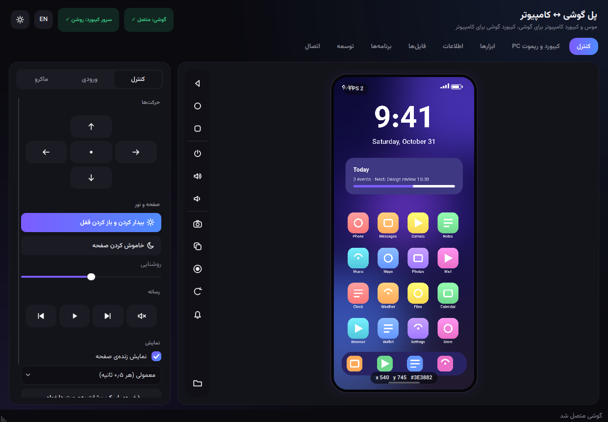
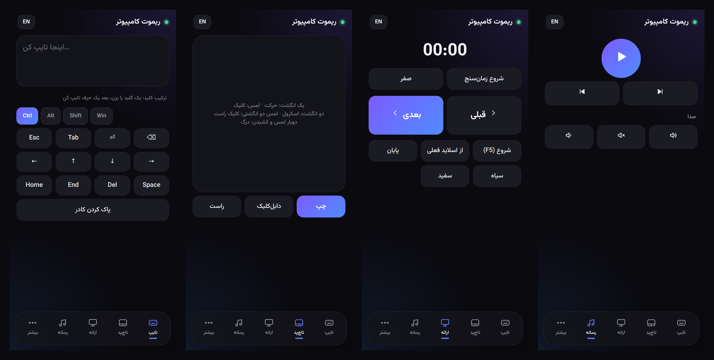
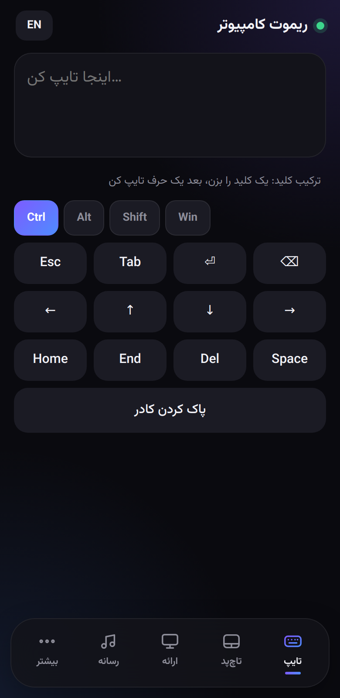
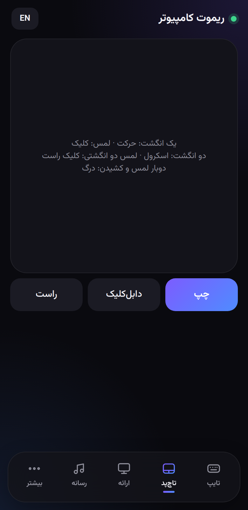
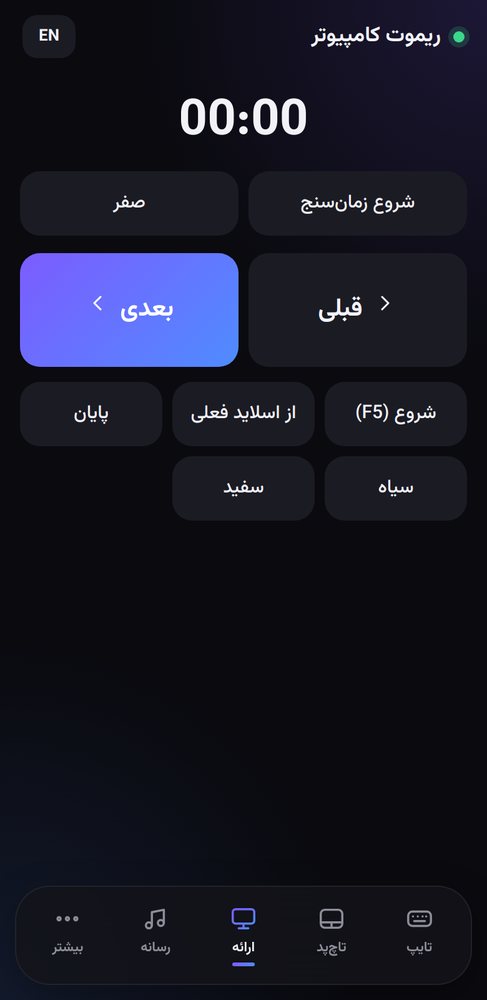
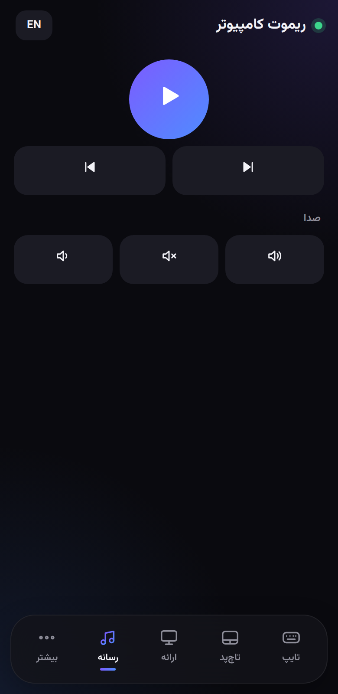
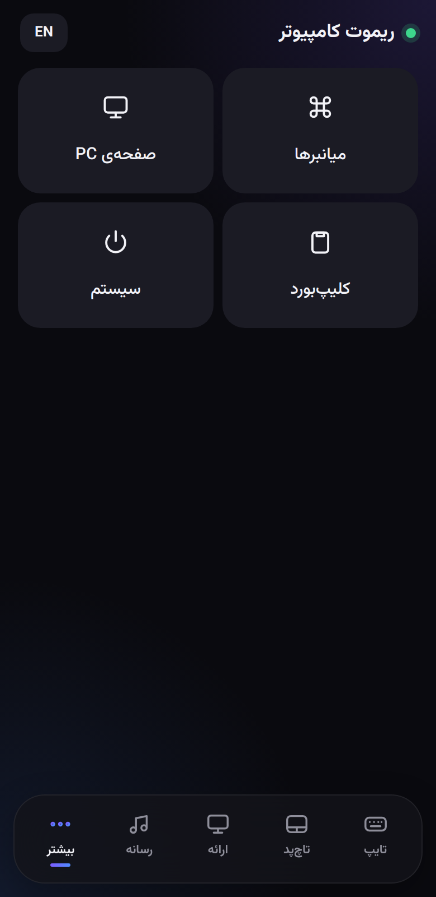
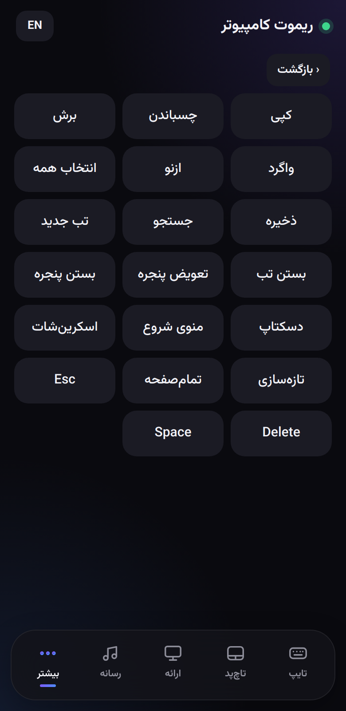
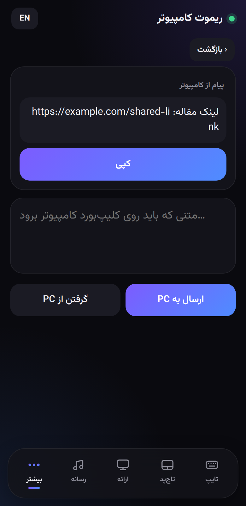
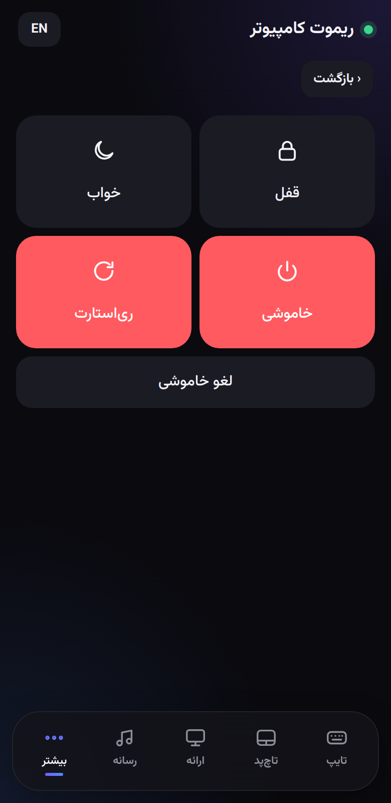

# راهنمای استفاده

[← فهرست مستندات](../README.md) · [English](../en/usage.md) · **فارسی**

گشتی در همه‌ی بخش‌های برنامه. تازه‌واردی؟ اول **[شروع سریع](getting-started.md)** را انجام بده.

- [پنجره](#پنجره)
- [تب کنترل](#تب-کنترل) — نمایش، موس، نوار ابزار، پنل، ماکرو
- [تب کیبورد و ریموت PC](#تب-کیبورد-و-ریموت-pc) — سرور
- [صفحه‌ی ریموت روی گوشی](#صفحهی-ریموت-روی-گوشی)
- [تب ابزارها](#تب-ابزارها)
- [تب اطلاعات](#تب-اطلاعات)
- [تب فایل‌ها](#تب-فایلها)
- [تب برنامه‌ها](#تب-برنامهها)
- [تب توسعه](#تب-توسعه)
- [تب اتصال](#تب-اتصال)
- [میانبرهای کیبورد](#میانبرهای-کیبورد)

---

## پنجره

نوار بالا: نام برنامه · دو قرص وضعیت (**گوشی: متصل ✓**، **سرور کیبورد: روشن ✓**) · دکمه‌ی زبان **EN / فا** · دکمه‌ی تم (خورشید/ماه).

- **تم** — تیره یا روشن؛ به خاطر سپرده می‌شود.
- **زبان** — فارسی یا انگلیسی. عوض‌کردن زبان برنامه را (حدود یک ثانیه) دوباره اجرا می‌کند تا همه‌ی متن‌ها و کل چیدمان بین راست‌به‌چپ و چپ‌به‌راست عوض شوند. اتصال گوشی خودکار دوباره برقرار می‌شود.
- هشت تب: کنترل · کیبورد و ریموت PC · ابزارها · اطلاعات · فایل‌ها · برنامه‌ها · توسعه · اتصال.
- نوار وضعیت (پایین) پیام‌های کوتاه نشان می‌دهد («اسکرین‌شات ذخیره شد: …»).

---

## تب کنترل

### نمایشگر گوشی

تصویر زنده‌ی صفحه‌ی گوشی (چند بار در ثانیه تازه می‌شود). نگاشت موس:

| موس | روی گوشی |
|---|---|
| **کلیک چپ** | لمس |
| **نگه‌داشتن** دکمه‌ی چپ > ۰٫۶ ثانیه | لمس طولانی |
| **کشیدن** | swipe (سرعت به سرعت کشیدنت بستگی دارد) |
| **چرخ موس** | اسکرول |
| **کلیک راست** | برگشت |
| **کلیک وسط** | خانه |
| **کیبورد** (وقتی نمایشگر فوکوس دارد) | متن را تایپ می‌کند؛ `Backspace`، `Enter`، `Esc`(= برگشت)، `Tab`، جهت‌ها، `Delete`، `Home`، `End`، `PgUp/PgDn` به‌صورت کلید فرستاده می‌شوند |

یک **موج** محل لمس را نشان می‌دهد؛ هنگام کشیدن، خطی دنبال نشانگر می‌آید. با رفتن موس روی تصویر، `x y #رنگ` پیکسل را می‌خوانی (برای تست رابط کاربری عالی است). قرص بالا-چپ **FPS** اندازه‌گیری‌شده است. اگر تصویر کاملاً سیاه باشد، برنامه دلیلش را می‌گوید (صفحه خاموش/قفل، یا صفحه‌ی محافظت‌شده مثل برنامه‌ی بانکی).

جهت صفحه از خود اسکرین‌شات تشخیص داده می‌شود، پس حالت افقی هم کار می‌کند.

### نوار ابزار (عمودی، کنار نمایشگر)

| آیکون | کار |
|---|---|
| ◁ ○ □ | برگشت · خانه · برنامه‌های اخیر |
| power، volume ± | روشن/خاموش صفحه · صدا بیشتر · صدا کمتر |
| دوربین | **اسکرین‌شات سریع** — با مهر زمانی در `Pictures/PhoneBridge` ذخیره می‌شود |
| کپی | کپی تصویر فعلی در کلیپ‌بورد |
| ضبط | **ضبط صفحه** (تا ۳ دقیقه، روی خود گوشی اجرا می‌شود، بعد به `Videos/PhoneBridge` می‌آید). دوباره کلیک کن تا متوقف شود. هنگام ضبط آیکون قرمز است |
| چرخش | هر کلیک ۹۰ درجه می‌چرخاند (چرخش خودکار را خاموش می‌کند) |
| زنگ | پرده‌ی اعلان‌ها را پایین می‌کشد |
| پوشه | پوشه‌ی تصاویر را باز می‌کند |

### پنل کناری

یک کنترل بخش‌بندی‌شده بین سه صفحه جابه‌جا می‌شود.

**کنترل**

- *حرکت‌ها* — یک D-pad: ↑ اسکرول به پایین، ↓ اسکرول به بالا، ← / → swipe؛ نقطه‌ی وسط وسط صفحه را دوبار لمس می‌کند.
- *بیدار کردن و باز کردن قفل* — گوشی را بیدار می‌کند و swipe بالا می‌زند (اگر PIN داری خودت وارد کن). *خاموش کردن صفحه* — خواب.
- *روشنایی* — نوار لغزنده (روشنایی را روی دستی می‌گذارد).
- *رسانه* — قبلی · پخش/توقف · بعدی · بی‌صدا (کلیدهای رسانه‌ی گوشی).
- *نمایش* — **نمایش زنده‌ی صفحه** روشن/خاموش؛ سرعت تازه‌سازی *سریع (۰٫۲۵ ثانیه) / معمولی (۰٫۵) / کم‌مصرف (۱)*؛ **ذخیره‌ی اسکرین‌شات به‌صورت دلخواه…** (جا را می‌پرسد).

**ورودی**

- *تایپ روی گوشی* — یک کادر متن؛ **Enter** یا **ارسال** آن را در فیلد فعال گوشی تایپ می‌کند. ASCII همه‌جا کار می‌کند؛ برای فارسی/یونیکد گزینه‌ی **فارسی/یونیکد با ADBKeyboard** را تیک بزن (کیبورد [ADBKeyBoard](https://github.com/senzhk/ADBKeyBoard) باید روی گوشی باشد — [رفع مشکل](troubleshooting.md#تایپ-فارسی-داخل-گوشی)).
- یادآوری کوتاه نگاشت موس.

**ماکرو**

1. **شروع ضبط** را بزن، لمس/swipe/کلیدها را روی نمایشگر انجام بده (دکمه می‌شود *توقف*)، متوقف کن.
2. **تکرار** (`∞` = تا وقتی توقف را بزنی) و سرعت (۰٫۵× … ۴×) را انتخاب و **پخش ماکرو** را بزن.
3. **ذخیره / باز کردن** ماکرو را به‌صورت فایل JSON (فهرستی از `{t, k, a}` — زمان، نوع، آرگومان‌ها) می‌نویسد که می‌توانی دستی ویرایشش کنی.

ماکرو مختصات خام را دوباره اجرا می‌کند، پس روی همان رزولوشن و حالت برنامه بهتر کار می‌کند.

---

## تب کیبورد و ریموت PC

این تب سرور وب کوچکی را کنترل می‌کند که [صفحه‌ی ریموت روی گوشی](#صفحهی-ریموت-روی-گوشی) را می‌سازد.

- **آدرس** — `http://<IP-شبکه>:<پورت>/?t=<توکن>`. در مرورگر گوشی باز کن یا QR زیرش را اسکن کن.
- **روشن/خاموش کردن سرور**، **کپی آدرس**، **توکن جدید** (لینک قبلی را باطل می‌کند — اگر لینک لو رفت)، **پورت** (پیش‌فرض ۸۷۶۵؛ عوض کن و سرور را خاموش/روشن کن).
- **رویدادها** — گزارش («گوشی وصل شد (192.168.1.50)»، «تایپ شد: ۱۲ نویسه»، درخواست‌های ردشده). *متن تایپ‌شده هرگز در گزارش نمی‌آید*، فقط طولش.
- **دسترسی‌های ریموت** *(پیش‌فرض خاموش و در هر بار اجرا دوباره خاموش)*
  - *نمایش و کنترل صفحه‌ی کامپیوتر از گوشی* — به صفحه اجازه می‌دهد **مانیتور اصلی** تو را پخش کند و رویش کلیک شود.
  - *دستورهای سیستمی (قفل / خواب / خاموشی)* — صفحه‌ی *سیستم* را فعال می‌کند (فقط ویندوز).
- **ارسال متن یا لینک از کامپیوتر به گوشی** — اینجا بنویس و **ارسال به صفحه‌ی گوشی** را بزن: در صفحه‌ی گوشی (*بیشتر ← کلیپ‌بورد*) با دکمه‌های کپی / باز کردن لینک ظاهر می‌شود و گوشی می‌لرزد.
- **امنیت** — یادآوری؛ [امنیت](security.md) را ببین.

بار اول فایروال ویندوز درباره‌ی Python می‌پرسد — **Private networks** را اجازه بده.

---

## صفحه‌ی ریموت روی گوشی

در مرورگر گوشی باز می‌شود؛ در حالت تیره یا روشن (از گوشی پیروی می‌کند) کار می‌کند، دکمه‌ی **EN / فا** خودش را دارد، فونت وزیرمتن را از کامپیوتر می‌گیرد (پس اینترنت لازم نیست) و روی لمس‌ها لرزش ملایم دارد.

نوار پایین: **تایپ · تاچ‌پد · ارائه · رسانه · بیشتر**.

<b>همه‌ی صفحه‌های ریموت گوشی (تصاویر)</b>

<table>
<tr>
  <td align="center" width="25%"> تایپ</td>
  <td align="center" width="25%"> تاچ‌پد</td>
  <td align="center" width="25%"> ارائه</td>
  <td align="center" width="25%"> رسانه</td>
</tr>
<tr>
  <td align="center" width="25%"> بیشتر</td>
  <td align="center" width="25%"> میانبرها</td>
  <td align="center" width="25%"> کلیپ‌بورد</td>
  <td align="center" width="25%"> سیستم</td>
</tr>
</table>

| صفحه | چه می‌کند |
|---|---|
| **تایپ** | یک کادر بزرگ: هرچه با کیبورد گوشی بنویسی روی کامپیوتر، جایی که مکان‌نما هست، تایپ می‌شود. تصحیح خودکار و **فارسی** را درست پشتیبانی می‌کند (*تفاوت* متن قبلی و جدید را می‌فرستد). زیرش **کلیدهای چسبنده** *Ctrl / Alt / Shift / Win* — یکی را بزن و بعد یک حرف تایپ کن تا ترکیبی مثل `Ctrl+C` فرستاده شود. دکمه‌ها: Esc، Tab، Enter، Backspace، جهت‌ها، Home، End، Del، Space. |
| **تاچ‌پد** | یک پد چندلمسی واقعی. **یک انگشت** = حرکت (با شتاب) · **لمس** = کلیک چپ · **لمس دوانگشتی** = کلیک راست · **کشیدن دوانگشتی** = اسکرول (طبیعی) · **لمس، سپس لمس و کشیدن** = درگ (انتخاب متن، جابه‌جایی پنجره). دکمه‌ها: چپ، دابل‌کلیک، راست. |
| **ارائه** | **قبلی / بعدی** بزرگ (کلیدهای جهت)، **شروع (F5)**، **از اسلاید فعلی (Shift+F5)**، **پایان (Esc)**، **سیاه (B)**، **سفید (W)** — با PowerPoint، LibreOffice، Google Slides و نمایشگرهای PDF کار می‌کند. **زمان‌سنج** هم دارد (شروع/توقف/صفر). |
| **رسانه** | پخش/توقف، قطعه‌ی قبلی/بعدی، صدا کمتر/بیشتر، بی‌صدا (کلیدهای رسانه‌ی سیستم). |
| **بیشتر ← میانبرها** | ۲۰ میانبر یک‌لمسی: کپی، چسباندن، برش، واگرد، ازنو، انتخاب همه، ذخیره، جستجو، تب جدید، بستن تب، تعویض پنجره (Alt+Tab)، بستن پنجره (Alt+F4)، دسکتاپ (Win+D)، منوی شروع، اسکرین‌شات (Win+Shift+S)، تازه‌سازی، تمام‌صفحه، Esc، Delete، Space. |
| **بیشتر ← صفحه‌ی PC** | نمایش زنده‌ی مانیتور اصلی کامپیوتر (به دسترسی بالا نیاز دارد). لمس = کلیک، نگه‌داشتن = کلیک راست، کشیدن = حرکت موس؛ دکمه‌های اضافه برای دابل‌کلیک و اسکرول. |
| **بیشتر ← کلیپ‌بورد** | متن را از گوشی **به کلیپ‌بورد PC** بفرست، **کلیپ‌بورد PC** را در کادر بگیر، و پیام‌های ارسالی از PC را ببین. |
| **بیشتر ← سیستم** | قفل · خواب · خاموشی (۳۰ ثانیه) · ری‌استارت (۳۰ ثانیه) · لغو خاموشی. هر کار خطرناک تأیید می‌خواهد. به دسترسی بالا نیاز دارد، فقط ویندوز. |

---

## تب ابزارها

اقدام‌های سریع که دستورهای `adb shell` اجرا می‌کنند. *نتیجه بسته به نسخه‌ی اندروید و سازنده فرق می‌کند*؛ نوار وضعیت نتیجه را نشان می‌دهد.

| کارت | موارد |
|---|---|
| **تنظیمات سریع** | Wi-Fi · داده‌ی موبایل · مزاحم نشوید · حالت تاریک · روشن‌ماندن صفحه هنگام شارژ · نمایش لمس‌ها و مختصات (overlay توسعه‌دهنده) — هر کدام **روشن / خاموش** |
| **تنظیمات** | نوار اندازه‌ی فونت (۰٫۸×–۲٫۰×) · زمان خاموشی صفحه (۱۵ ثانیه … ۳۰ دقیقه) · میانبر **باز کردن تنظیمات** (Wi-Fi، بلوتوث، نمایشگر، صدا، باتری، حافظه، برنامه‌ها، گزینه‌های توسعه‌دهنده، دسترس‌پذیری، موقعیت مکانی، زبان، درباره‌ی گوشی) |
| **نگهداری** | بستن برنامه‌های پس‌زمینه · پاک کردن کش همه‌ی برنامه‌ها *(روی بعضی گوشی‌ها محدود است)* |
| **ارسال به گوشی** | باز کردن **لینک** در مرورگر گوشی · باز کردن **شماره‌گیر** با یک شماره · ساخت **پیامک** (ارسال را خودت روی گوشی می‌زنی) |
| **عکس بگیر و بیاور** | دوربین را باز می‌کند، کلید شاتر را می‌زند، منتظر فایل جدید در `DCIM/Camera` می‌ماند و آن را به `Pictures/PhoneBridge` کپی می‌کند. اگر دوربینت به کلید واکنش نشان نداد، روی نمایشگر شاتر را بزن و **آخرین عکس گوشی را بیاور** را بزن. |

---

## تب اطلاعات

- **مشخصات دستگاه** — مدل، سازنده، نسخه‌ی اندروید/API، معماری CPU، وصله‌ی امنیتی، رزولوشن، تراکم، RAM (کل/آزاد)، حافظه‌ی داخلی (کل/استفاده‌شده)، IP، سریال، نسخه‌ی سیستم. **ذخیره‌ی گزارش** فایل متنی می‌نویسد.
- **باتری** — گیج با درصد، دما و وضعیت شارژ.
- **پایش زنده** — درصد باتری و درصد RAM مصرفی هر ۳ ثانیه (۶۰ نمونه‌ی آخر).
- **تست اینترنت گوشی** — `ping` را *روی گوشی* به یک میزبان می‌زند (پیش‌فرض `8.8.8.8`؛ اگر آن آدرس جایی که هستی بسته است عوضش کن) و تأخیر میانگین/کمینه/بیشینه را می‌گوید.

---

## تب فایل‌ها

مدیر فایل گوشی.

- نوار مسیر، **بالاتر**، مکان‌های سریع (حافظه‌ی داخلی، Download، DCIM، Pictures، Documents، Movies، Music، ریشه)، تازه‌سازی.
- اول پوشه‌ها، بعد فایل‌ها با حجم و تاریخ. روی پوشه **دوبار کلیک** = باز کردن؛ روی فایل دوبار کلیک = **دانلود در پوشه‌ی موقت و باز کردن** با برنامه‌ی پیش‌فرض کامپیوتر.
- دکمه‌ها: **دانلود** (در پوشه‌ای که انتخاب می‌کنی؛ چندتایی و پوشه هم کار می‌کند) · **ارسال فایل** · **پوشه‌ی جدید** · **تغییر نام** · **حذف** (تأیید می‌گیرد) · **نصب APK**.
- **کشیدن و رها کردن**: فایل‌ها را هرجای پنجره رها کن ← در پوشه‌ی `Download` گوشی کپی می‌شوند؛ **فایل‌های `.apk` به‌جای کپی، نصب می‌شوند**.

---

## تب برنامه‌ها

- به‌صورت پیش‌فرض برنامه‌های شخص‌ثالث؛ با تیک **شامل برنامه‌های سیستمی** همه. کادر جستجوی زنده.
- برنامه را انتخاب کن تا نسخه و تاریخ نصب/به‌روزرسانی‌اش را ببینی، بعد: **اجرا** · **توقف اجباری** · **تنظیمات برنامه روی گوشی** · **استخراج APK به کامپیوتر** (همه‌ی APKهای split) · **پاک کردن داده‌ها** (تأیید می‌گیرد) · **حذف برنامه** (تأیید می‌گیرد) · **نصب APK از کامپیوتر**.
- **ذخیره‌ی لیست** نام همه‌ی بسته‌ها را در فایل متنی می‌نویسد.

---

## تب توسعه

- **Logcat** — جریان زنده. فیلتر سطح (همه / Debug به بالا / Info به بالا / Warning به بالا / Error به بالا)، جستجوی متن، **مکث**، پاک کردن نمایش، **ذخیره در فایل**، **پاک کردن لاگ گوشی** (`logcat -c`). خطوط رنگی‌اند.
- **ترمینال adb** — هر دستور `adb shell` را بنویس؛ `↑ / ↓` تاریخچه. دکمه‌های سریع: مشخصات، باتری، برنامه‌ها، شبکه، پردازش‌ها، حافظه، برنامه‌ی فعال. دستورها بعد از ۶۰ ثانیه قطع می‌شوند؛ پس `top -n 1` بنویس، نه فقط `top`.

---

## تب اتصال

قدم‌به‌قدم در **[شروع سریع](getting-started.md#۳-اتصال--یکی-از-روشها-را-انتخاب-کن)** آمده. اضافه‌ها:

- **گزارش adb** — خروجی خام هر تلاش اتصال؛ آن را به گزارش خطا پیوست کن.
- **تنظیمات برنامه**
  - *هنگام بستن پنجره، در سینی سیستم بماند* — بستن پنجره آن را پنهان می‌کند؛ برای خروج از منوی آیکون سینی **خروج** را بزن.
  - *اتصال خودکار مجدد وقتی گوشی قطع شد* — هر ۵ ثانیه چک می‌کند؛ برای Wi-Fi دوباره `adb connect` به آخرین آدرس می‌زند. به‌صورت پیش‌فرض روشن است.

---

## میانبرهای کیبورد

داخل پنجره‌ی برنامه فعال‌اند:

| کلیدها | کار |
|---|---|
| `Alt + ←` | برگشت |
| `Alt + Home` | خانه |
| `Alt + ↓` | برنامه‌های اخیر |
| `Ctrl + S` | اسکرین‌شات سریع |
| `Ctrl + R` | شروع / توقف ضبط صفحه |
| `Ctrl + Shift + C` | کپی تصویر فعلی گوشی |

بعدی: **[فهرست امکانات](features.md)** · **[رفع مشکل](troubleshooting.md)**

